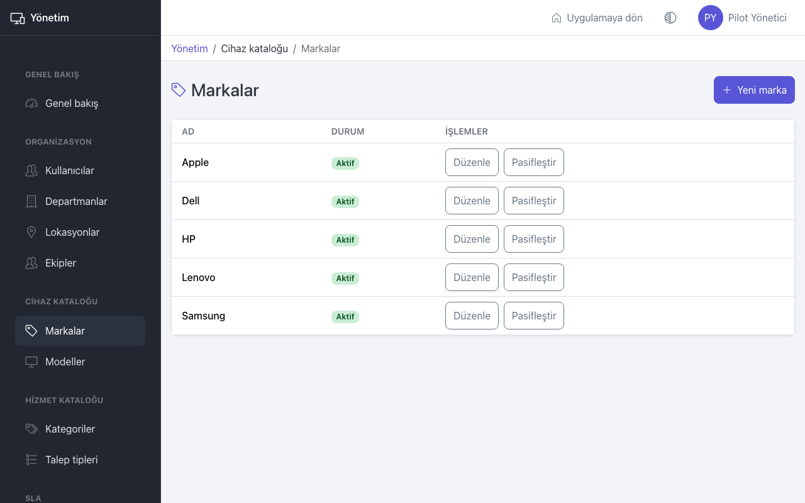
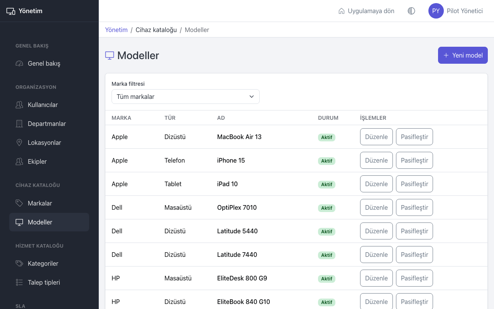
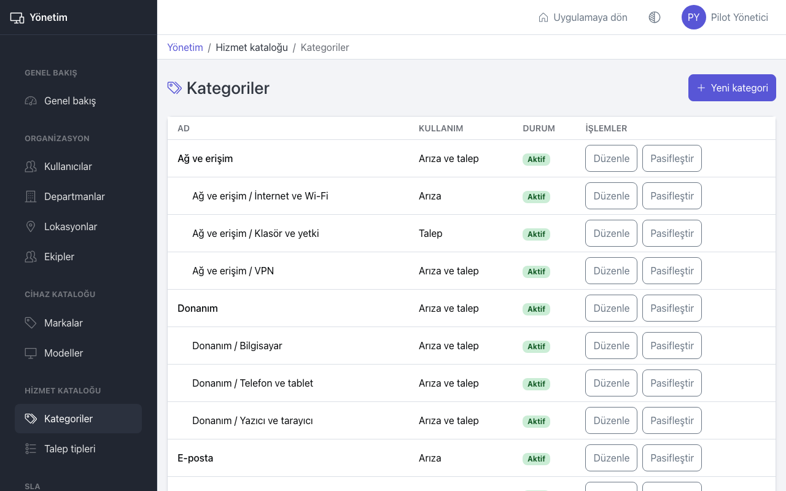
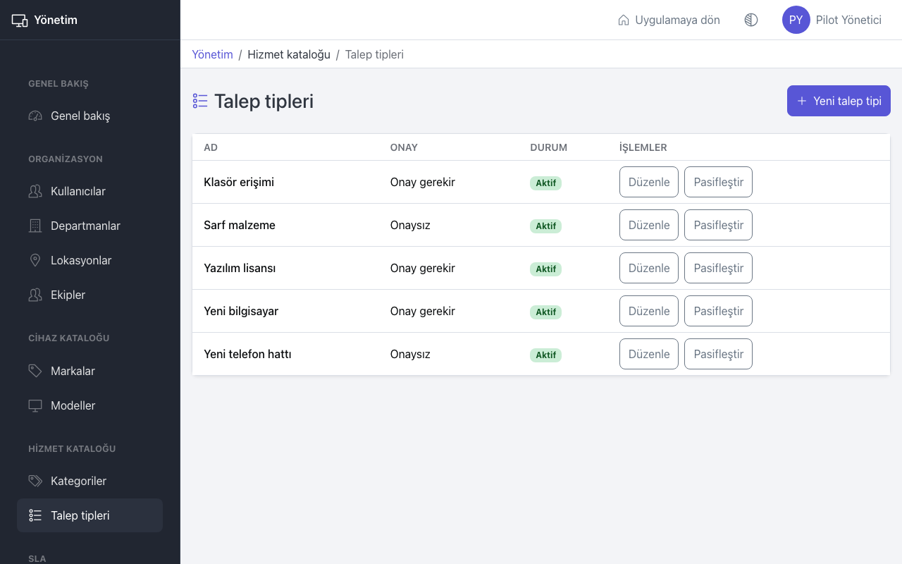

# Yönetim: cihaz ve hizmet kataloğu

Bu sayfa yöneticiler içindir. İki katalog vardır:

- **Cihaz kataloğu**: **Markalar** ve **Modeller**. Envantere cihaz eklerken bu listelerden seçilir.
- **Hizmet kataloğu**: **Kategoriler** ve **Talep tipleri**. Çalışanlar arıza ve talep açarken bunlardan seçer.

## Markalar

1. **Markalar** sayfasında **Yeni marka** düğmesine basın.
2. **Ad** girin, örneğin "Lenovo", ve **Oluştur** düğmesine basın.

- **Düzenle** ile adı değiştirin. Ad değişince bu markadaki tüm cihazlarda yeni ad görünür.
- **Pasifleştir** ile marka yeni cihazlarda seçilemez olur. Mevcut cihazlar etkilenmez. **Aktifleştir** ile geri açılır.
- Aynı ad iki kez eklenemez; büyük-küçük harf ve boşluk farkı aynı ad sayılır.

## Modeller

1. **Modeller** sayfasında **Yeni model** düğmesine basın.
2. **Marka** ve **Tür** (Masaüstü, Dizüstü, Telefon, Tablet) seçin.
3. **Ad** girin, örneğin "ThinkPad T14 Gen 4", ve **Oluştur** düğmesine basın.

Listeyi **Marka filtresi** ile daraltabilirsiniz. Model pasifleştirilince yeni cihazlarda seçilemez; mevcut cihazlar etkilenmez.

IT personeli cihaz eklerken bir marka veya model bulamazsa **Listede yoksa tanım eksik: yöneticiye bildirin.** uyarısını görür. CSV içe aktarmada da tanımsız marka veya model "Tanım eksik" hatası verir. İçe aktarmadan önce kataloğu tamamlayın.

## Kategoriler

Kategoriler en fazla iki seviyelidir: bir ana kategori ve altında alt kategoriler (örneğin "Donanım / Bilgisayar").

1. **Kategoriler** sayfasında **Yeni kategori** düğmesine basın.
2. **Kategori adı** girin.
3. Alt kategori ise **Üst kategori** seçin; ana kategori ise **Üst kategori yok** bırakın.
4. **Kullanım** seçin:
   - **Arıza**: Yalnızca arıza bildirirken çıkar.
   - **Talep**: Yalnızca talep oluştururken çıkar.
   - **Arıza ve talep**: İkisinde de çıkar.
5. **Oluştur** düğmesine basın.

Kullanılmayan kategoriyi **Pasifleştir** ile kaldırın; eski kayıtlar kategorisini korur.

## Talep tipleri

1. **Talep tipleri** sayfasında **Yeni talep tipi** düğmesine basın.
2. **Talep tipi adı** girin, örneğin "Yazılım lisansı".
3. Bu talepler onaydan geçmeliyse **Yönetici onayı gerekir** kutusunu işaretleyin. Listede **Onay gerekir** veya **Onaysız** yazar.
4. **Oluştur** düğmesine basın.

Onay gerektiren talepler, talep sahibinin departmanının onaylayıcısına gider (bkz. [Onaylar](approvals.md)).

## İpuçları

- Kategori ve talep tipi adlarını çalışanların anlayacağı dille yazın; teknik kısaltmalardan kaçının.
- Az ve net kategori, doğru raporlar demektir. Benzer kategorileri birleştirin.
