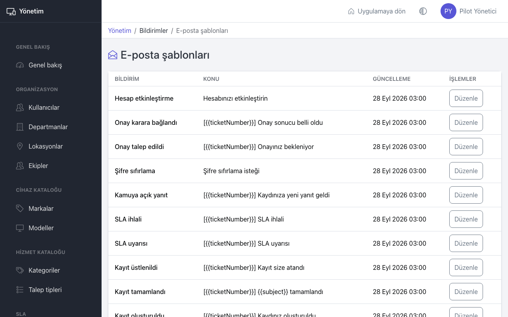
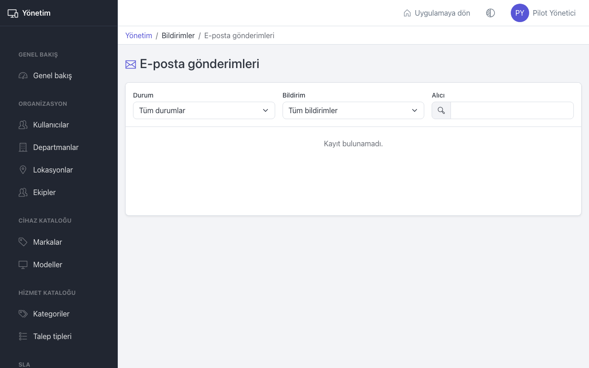
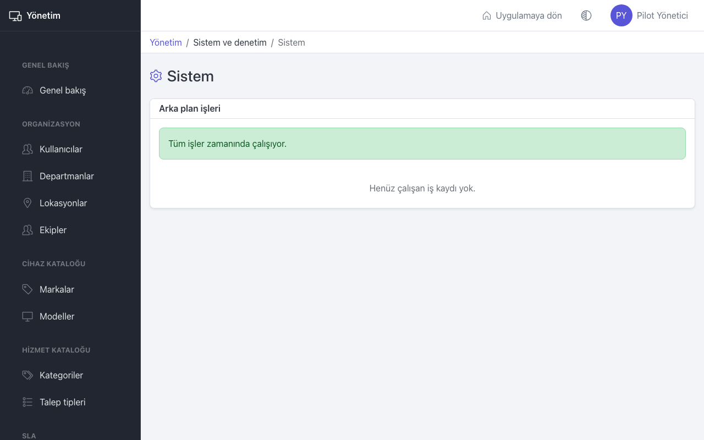

# Yönetim: e-posta ve sistem

Bu sayfa yöneticiler içindir: bildirim e-postalarının metinlerini düzenlemek, gönderimleri izlemek ve arka plan işlerinin çalıştığını kontrol etmek.

## E-posta şablonları

Her bildirim türünün bir şablonu vardır: "Kayıt oluşturuldu", "Kamuya açık yanıt", "Onay talep edildi", "SLA uyarısı", "Hesap etkinleştirme", "Şifre sıfırlama" gibi.

1. **E-posta şablonları** sayfasında değiştirmek istediğiniz bildirimin satırında **Düzenle** düğmesine basın.
2. **Konu** ve **İçerik** alanlarını düzenleyin.
3. Kayıt numarası, kişi adı gibi değişen bilgiler için **Kullanılabilir değişkenler** listesindeki değişkenleri kullanın. Değişkenleri çift süslü parantez içinde yazın, örneğin `{{ticketNumber}}`. Listede olmayan bir değişken yazarsanız şablon kaydedilmez.
4. **Kaydet** düğmesine basın.

Değişiklik bundan sonra gönderilen e-postalarda geçerli olur.

## E-posta gönderimleri

**E-posta gönderimleri** sayfası gönderilen ve gönderilemeyen her e-postayı listeler: alıcı, bildirim, konu, durum, deneme sayısı, son hata ve tarih.

- **Durum**, **Bildirim** ve **Alıcı** filtreleriyle arayın.
- Durumlar: **Bekliyor**, **Gönderiliyor**, **Gönderildi**, **Başarısız**.
- **Başarısız** bir e-postayı **Yeniden dene** ile tekrar gönderime alın. Önce **Son hata** sütununu okuyun; sorun e-posta sunucusundaysa sistem yöneticisine bildirin.

Kullanıcı pasifleştirildiyse veya e-posta adresi değiştiyse eski e-posta yeniden gönderilemez. Hesap bağlantısı gerekiyorsa kullanıcıya **Şifre sıfırla** ile yeni bağlantı gönderin.

## Sistem

**Sistem** sayfası arka plan işlerinin (e-posta gönderimi, SLA izleme, dışa aktarım, temizlik) zamanında çalışıp çalışmadığını gösterir.

- Üstteki kutu genel durumu söyler: **Tüm işler zamanında çalışıyor.** ya da **Bazı işler zamanında çalışmadı.**
- **Arka plan işleri** tablosunda her iş için son çalışma zamanı, çalışma aralığı ve durum görünür. **Gecikmiş** veya **Rapor vermiyor** görürseniz e-postalar gitmiyor, SLA uyarıları çıkmıyor veya dışa aktarımlar hazırlanmıyor olabilir. Sistem yöneticisine bildirin.
- Tablo boşsa (**Henüz çalışan iş kaydı yok.**) arka plan hizmeti hiç çalışmamıştır.

**Genel bakış** sayfasındaki **Kurulum kontrolleri** de bir iş sorunluysa uyarı verir.

## İpuçları

- Şablon metinlerini kısa tutun ve kaydı açan bağlantıyı silmeyin; kullanıcılar e-postadan kayda bu bağlantıyla gider.
- Kullanıcı "e-posta gelmedi" derse önce **E-posta gönderimleri** sayfasında alıcıya göre arayın.
