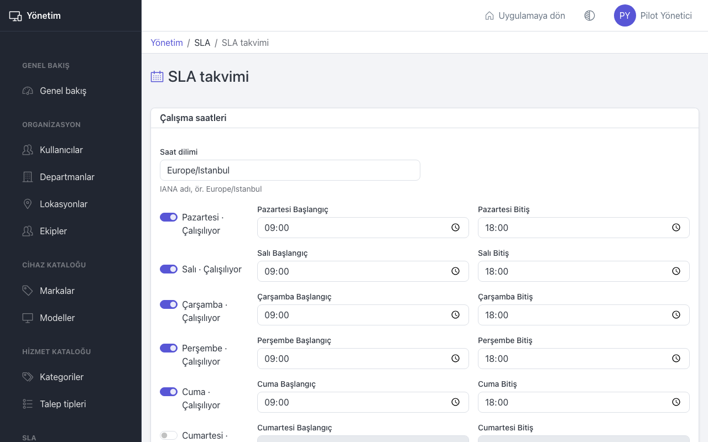
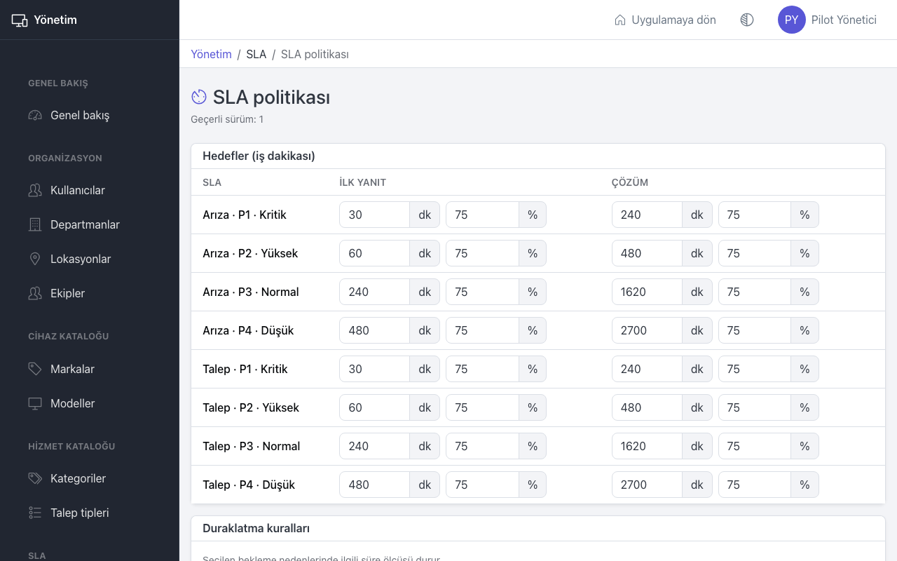

# Yönetim: SLA

Bu sayfa yöneticiler içindir. SLA, IT ekibinin bir kayda ne kadar sürede ilk yanıt vereceğini ve kaydı ne kadar sürede çözeceğini belirleyen hedeflerdir. Süreler yalnızca çalışma saatlerinde işler.

## SLA takvimi

1. **SLA takvimi** sayfasını açın.
2. **Saat dilimi** alanına saat dilimini yazın, örneğin `Europe/Istanbul`.
3. **Çalışma saatleri** bölümünde her gün için:
   - Çalışılan günlerde anahtarı açık bırakın (**Çalışılıyor**), **Başlangıç** ve **Bitiş** saatlerini girin.
   - Çalışılmayan günlerde anahtarı kapatın (**Kapalı**).
4. **Takvimi kaydet** düğmesine basın.

En az bir çalışma günü olmalıdır. Her gün için tek bir saat aralığı girilir ve başlangıç bitişten önce olmalıdır.

### Tatil günleri

1. **Tatil günleri** bölümünde **Tarih** ve **Ad** girin, örneğin "Cumhuriyet Bayramı".
2. **Tatil ekle** düğmesine basın.

Tatil günlerinde SLA süresi işlemez. Yanlış eklenen tatili **Kaldır** ile silin. Yılbaşında yeni yılın tatillerini eklemeyi unutmayın.

## SLA politikası

**Hedefler (iş dakikası)** tablosunda her kayıt türü (arıza, talep) ve öncelik (P1–P4) için iki hedef vardır: ilk yanıt ve çözüm. Her hedefte:

- Dakika kutusu: hedef süre, çalışma dakikası olarak. Örneğin 240 dakika = 4 çalışma saati.
- Yüzde kutusu: uyarı eşiği. Örneğin 75 yazarsanız sürenin %75'i dolunca kayıt "Risk" olur, **SLA Riski** kuyruğuna düşer ve ilgili kişilere "SLA uyarısı" e-postası gider.

**Duraklatma kuralları** bölümünde her bekleme nedeni için seçin:

- **İlk yanıt durur**: Kayıt bu nedenle bekletilince ilk yanıt süresi durur.
- **Çözüm durur**: Kayıt bu nedenle bekletilince çözüm süresi durur.

Örneğin **Kullanıcıdan yanıt bekleniyor** için **Çözüm durur** seçilirse, kullanıcıdan cevap beklenen süre çözüm süresine sayılmaz.

Değişiklikleri **Yeni sürüm olarak kaydet** ile kaydedin. Sayfanın üstünde geçerli sürüm numarası yazar.

Hedefler 1 veya daha büyük, uyarı yüzdesi 1 ile 99 arasında olmalıdır.

## Değişiklikler mevcut kayıtları nasıl etkiler

- Yeni sürüm yalnızca bundan sonra açılan kayıtlara uygulanır. Açık kayıtlar başladıkları sürümün hedefleriyle devam eder.
- Kaydın önceliği değişirse hedef yeni önceliğe göre yeniden hesaplanır.
- Aktarma süreyi sıfırlamaz. Onay bekleyen bir talepte çözüm süresi onay gelene kadar durur.

## İpuçları

- Hedefleri ekibinizin gerçek kapasitesine göre koyun. [Raporlar](reports.md) sayfasındaki **Olaylar** sekmesinde SLA uyumunu izleyin.
