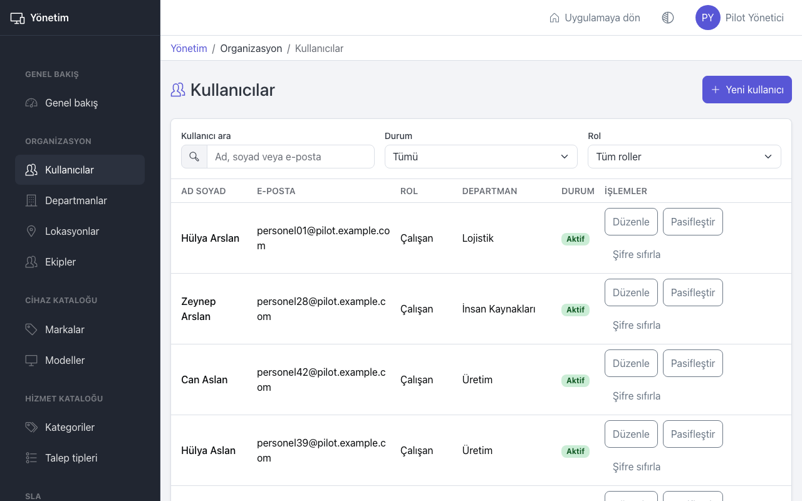
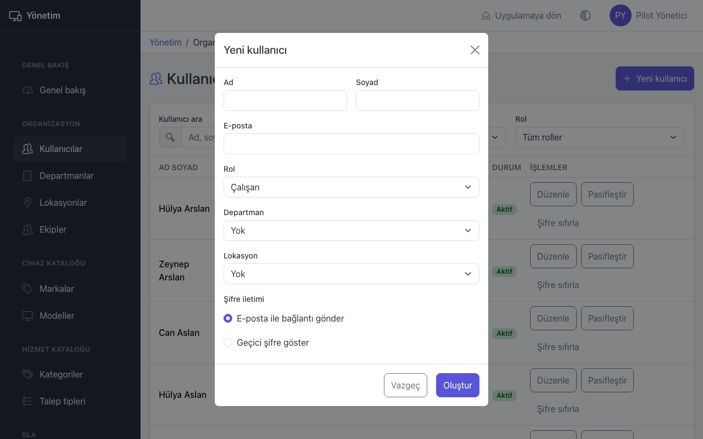
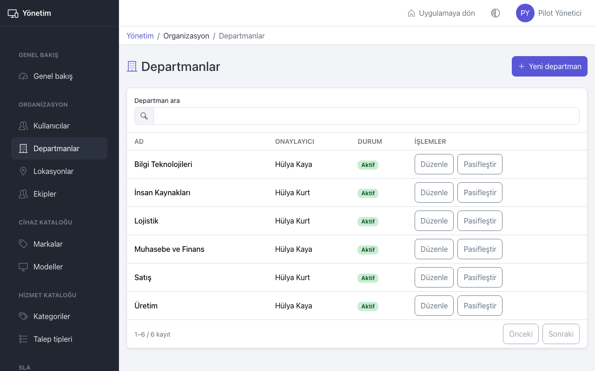
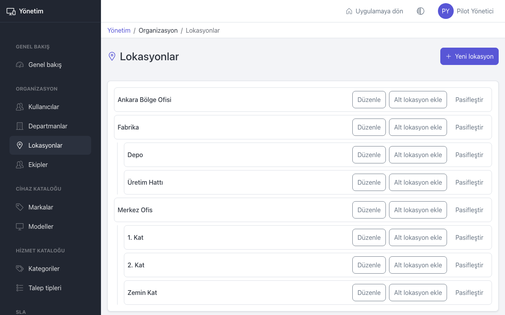
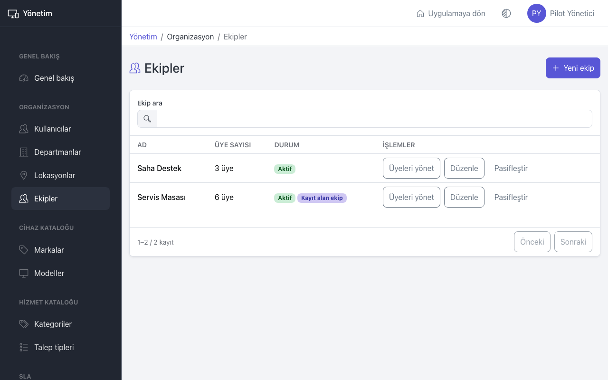
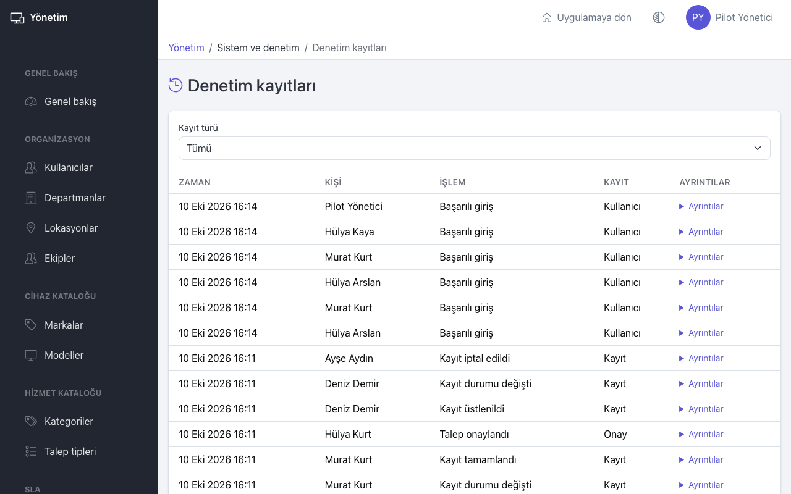

# Yönetim: kullanıcılar ve organizasyon

Bu sayfa yöneticiler içindir: kullanıcıları, departmanları, lokasyonları ve ekipleri yönetmek, kurulum eksiklerini ve denetim kayıtlarını görmek.

Yönetim ekranlarını açmak için üst çubuktaki **Yönetim** bağlantısına basın. Uygulamaya **Uygulamaya dön** ile dönersiniz.

## Genel bakış

**Genel bakış** sayfasındaki **Kurulum kontrolleri** kartı eksik tanımları listeler:

- **Onaylayıcısı olmayan departmanlar**: Bu departmanların onay gerektiren talepleri onaylayıcısız kalır.
- "Varsayılan karşılama ekibi seçilmemiş.": Çalışanlar kayıt açamaz. **Ekiplere git** ile düzeltin.
- "Arka plan işlerinden en az biri sorunlu.": E-posta veya SLA izleme çalışmıyor olabilir. **Sistem durumuna git** ile bakın.

Her şey tamamsa **Eksik kurulum tanımı bulunmadı.** yazar.

## Kullanıcılar

Listede **Kullanıcı ara** alanıyla ada, soyada veya e-postaya göre arayın; **Durum** ve **Rol** ile süzün.

### Yeni kullanıcı ekleme

1. **Kullanıcılar** sayfasında **Yeni kullanıcı** düğmesine basın.
2. **Ad**, **Soyad** ve **E-posta** girin.
3. **Rol** seçin: **Çalışan**, **IT personeli** veya **Yönetici**.
4. **Departman** ve **Lokasyon** seçin. Departman, talep onaylarında kimin onaylayacağını belirler.
5. **Şifre iletimi** seçin:
   - **E-posta ile bağlantı gönder** (önerilen): Kullanıcıya "Hesap etkinleştirme" e-postası gider; kullanıcı şifresini kendisi belirler.
   - **Geçici şifre göster**: Ekranda bir geçici şifre çıkar. Bu şifre yalnızca bir kez gösterilir; **Kopyala** ile alıp kullanıcıya güvenli bir yoldan iletin. Kullanıcı ilk girişte şifresini değiştirir.
6. **Oluştur** düğmesine basın.

### Düzenleme, pasifleştirme, şifre sıfırlama

- **Düzenle**: Ad, e-posta, rol, departman ve lokasyonu değiştirir. Rol değişince kullanıcının oturumu kapanır.
- **Pasifleştir**: Kullanıcı artık giremez; açık oturumu hemen kapanır ve e-posta almaz. **Aktifleştir** ile geri açılır.
- **Şifre sıfırla**: Aynı iki iletim yolundan birini seçerek yeni şifre verir. Kullanıcının açık oturumu kapanır.

Sistemdeki son aktif yönetici pasifleştirilemez ve rolü değiştirilemez.

## Departmanlar

1. **Departmanlar** sayfasında **Yeni departman** düğmesine basın.
2. **Departman adı** girin.
3. **Onaylayıcı yönetici** seçin. Bu departmandaki kişilerin onay gerektiren taleplerini bu kişi onaylar. Onaylayıcı aktif bir yönetici olmalıdır.
4. **Oluştur** düğmesine basın.

Onaylayıcı kendi açtığı talebi onaylayamaz; bu durumda talep onaylayıcısız kalır ve bir yönetici **Onay yönetimi** sayfasında onaylayıcı atar (bkz. [Onaylar](approvals.md)).

## Lokasyonlar

Lokasyonlar ağaç şeklindedir: örneğin "Merkez Ofis" altında "Zemin Kat", "1. Kat".

- En üst seviyede lokasyon için **Yeni lokasyon** düğmesine basın, **Lokasyon adı** girin, **Üst lokasyon** olarak **Yok (en üst seviye)** bırakın.
- Bir lokasyonun altına eklemek için o satırdaki **Alt lokasyon ekle** düğmesine basın.
- **Düzenle** ile adı veya **Üst lokasyon** değiştirilebilir. Bir lokasyon kendi altına taşınamaz.
- **Pasifleştir** ile kullanımdan kaldırın. Önce alt lokasyonları pasifleştirmeniz gerekir.

## Ekipler

1. **Ekipler** sayfasında **Yeni ekip** düğmesine basın.
2. **Ekip adı** girin.
3. Çalışanların açtığı yeni kayıtlar bu ekibe düşsün istiyorsanız **Yeni kayıtları bu ekip alsın** kutusunu işaretleyin. Yalnızca bir ekip seçilebilir; bu ekip listede **Kayıt alan ekip** etiketiyle görünür.
4. **Oluştur** düğmesine basın.
5. **Üyeleri yönet** ile ekibin üyelerini açın. **Eklenecek kişi** seçip **Üye ekle** ile ekleyin, **Çıkar** ile çıkarın.

Ekibe yalnızca **IT personeli** ve **Yönetici** rolündeki aktif kullanıcılar eklenebilir. Bir kişi birden fazla ekipte olabilir.

## Denetim kayıtları

**Denetim kayıtları** sayfası sistemde kimin neyi ne zaman yaptığını gösterir: girişler, kullanıcı değişiklikleri, kayıt işlemleri, cihaz hareketleri ve daha fazlası.

1. **Kayıt türü** listesiyle süzün (örneğin "Kullanıcı" veya "Cihaz").
2. Bir satırın **Ayrıntılar** bölümünü açarak değişiklikten **Önce** ve **Sonra** değerlerini görün.

## İpuçları

- Bir çalışan işten ayrıldığında hesabını silmek yerine **Pasifleştir** kullanın; geçmiş kayıtları korunur.
- Kullanıcı kilitlendiyse (art arda 5 hatalı giriş) 15 dakika sonra kendiliğinden açılır. Şifresini unuttuysa **Şifre sıfırla** kullanın.
