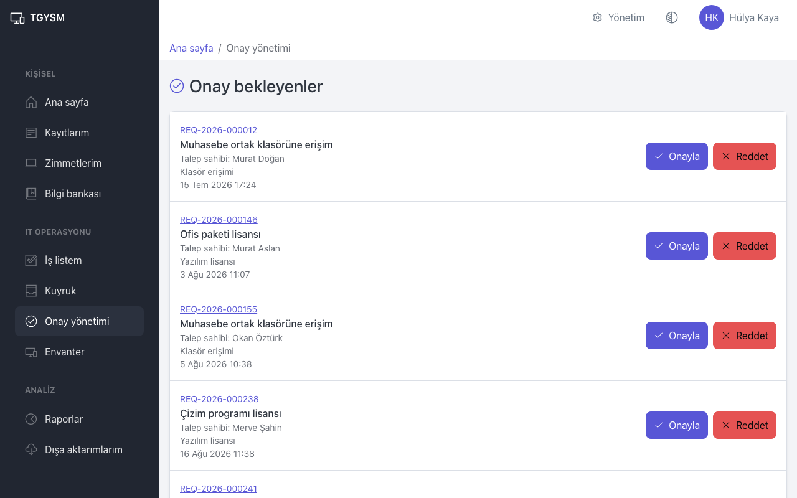

# Onaylar

Bu sayfa onaylayıcılar içindir. Onaylayıcılar **Yönetici** rolündeki kişilerdir.

## Onay ne zaman istenir

Bazı talep tipleri yönetici onayı ister (örneğin "Yeni bilgisayar"). Böyle bir talep açılınca:

- Talep **Beklemede** durumunda, **Yönetici onayı bekleniyor** nedeniyle bekler. IT ekibi onay gelmeden talebi tamamlayamaz.
- Onaylayıcı, talep sahibinin departmanının **Onaylayıcı yönetici** olarak seçilmiş kişisidir. Bu kişi aktif bir yönetici değilse ya da talebi kendisi açtıysa talep onaylayıcısız kalır; bir yöneticinin onaylayıcı ataması gerekir.
- Onaylayıcıya "Onay talep edildi" e-postası gider.

## Talepleri onaylama veya reddetme

1. Menüden **Onay yönetimi** sayfasını açın. **Onay bekleyenler** listesi açılır.
2. Listede size atanmış talepler ve onaylayıcısı olmayan talepler görünür. Her satırda numara, konu, talep sahibi, talep tipi ve tarih yazar.
3. Ayrıntıyı görmek için talep numarasına basın.
4. Karar verin:
   - **Onayla**: Açılan pencerede **Onayla** ile onaylayın. Talep açılır ve IT ekibine düşer.
   - **Reddet**: Açılan pencerede **Neden** alanına red nedenini yazın ve **Onayla** düğmesine basın. Talep **İptal edildi** olur; sonuç **Onay reddedildi** olarak kaydedilir.

Talep sahibine karar e-postayla bildirilir. Red nedeni talep sahibi tarafından görülür; açık ve kibar yazın.

Liste boşsa **Onay bekleyen talep yok.** yazar.

## Onaylayıcısı olmayan talebe onaylayıcı atama

Onaylayıcısı olmayan taleplerde **Onayla** ve **Reddet** yerine **Onaylayıcı ata** düğmesi görünür.

1. **Onaylayıcı ata** düğmesine basın.
2. **Onaylayıcı** listesinden bir yönetici seçin.
3. **Neden** alanına kısa bir açıklama yazın.
4. **Onaylayıcıyı ata** düğmesine basın.

Kararı yalnızca atanan onaylayıcı verebilir. Bu durum sık oluyorsa departmana onaylayıcı tanımlayın (bkz. [Yönetim: kullanıcılar ve organizasyon](admin-users-and-organization.md)).

## Onayın geçersiz kılınması

Onaylanmış bir talebin kapsamı sonradan değişirse IT ekibi talep sayfasında **Onayı geçersiz kıl** ile onayı iptal edebilir. Talep yeniden **Beklemede** durumuna geçer ve yeni bir onay istenir.

## İpuçları

- Aynı talebi iki kişi aynı anda karara bağlamaya çalışırsa yalnızca ilk karar geçerli olur; diğerine uyarı çıkar.
- İptal edilen bir talebin bekleyen onayı kendiliğinden düşer.
