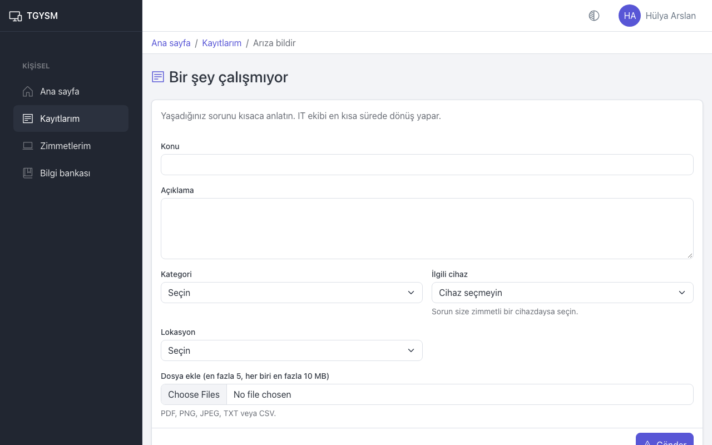
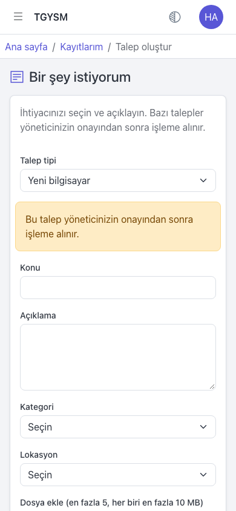
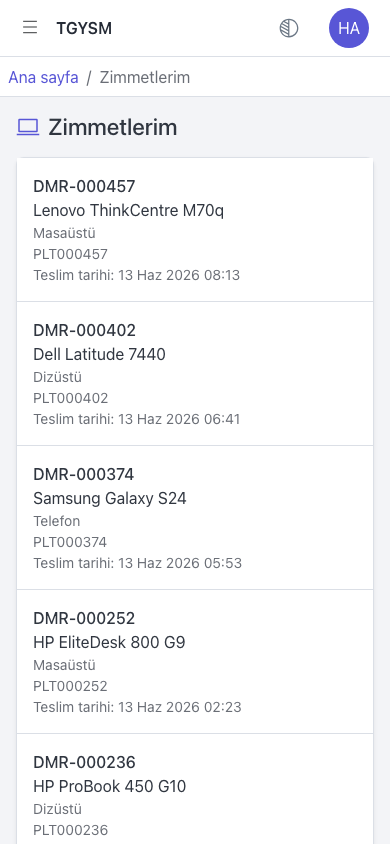
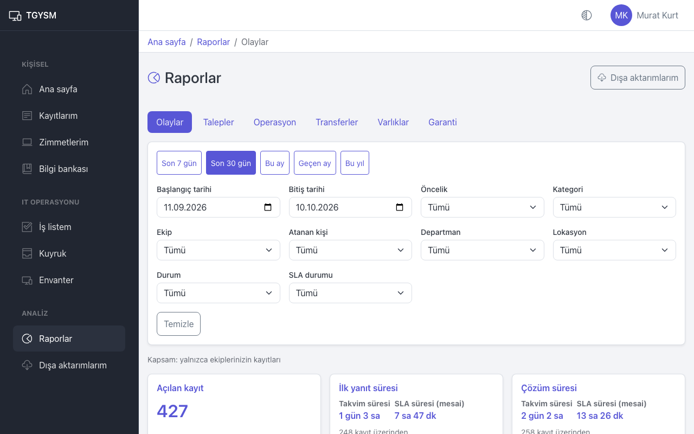
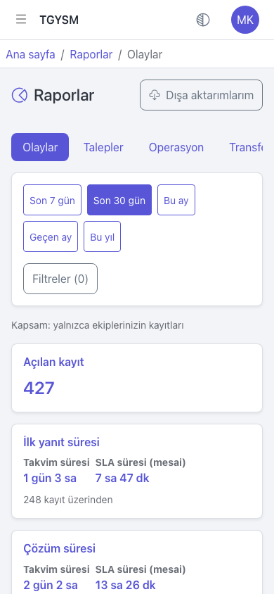
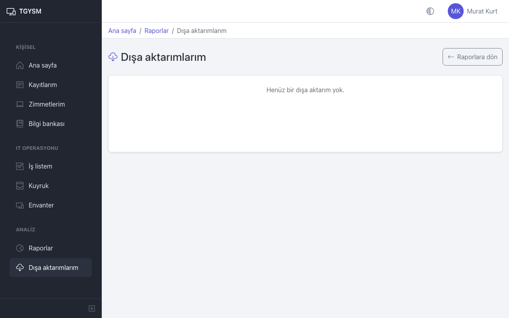

# Başlarken

Bu sayfa herkes içindir: TGYSM'ye nasıl girilir, şifre nasıl belirlenir ve ekranlar nasıl kullanılır.

## Hesabınız ve rolünüz

Hesabınızı yönetici açar. Her hesabın bir rolü vardır; ekranda gördüğünüz menüler bu role göre değişir.

| Rol | Neler yapabilir |
|---|---|
| **Çalışan** | Arıza bildirir, talep oluşturur, kendi kayıtlarını ve zimmetlerini görür, bilgi bankasını okur. |
| **IT personeli** | Çalışanın yaptıklarına ek olarak ekibine düşen kayıtları çözer, envanteri yönetir, makale yazar, raporları görür. |
| **Yönetici** | IT personelinin yaptıklarına ek olarak onay bekleyen talepleri karara bağlar ve **Yönetim** ekranlarını kullanır. |

Talepleri onaylayan kişiler (onaylayıcılar) her zaman **Yönetici** rolündedir.

## Hesabınızı etkinleştirme

Yöneticiniz hesabınızı açarken iki yoldan birini seçer:

- **E-posta ile bağlantı gönder**: E-posta kutunuza bir "Hesap etkinleştirme" iletisi gelir.
  1. İletideki bağlantıyı açın. **Şifre belirle** ekranı açılır.
  2. **Yeni şifre** ve **Yeni şifre (tekrar)** alanlarına aynı şifreyi yazın.
  3. **Şifreyi kaydet** düğmesine basın.
  4. **Giriş sayfasına git** bağlantısıyla giriş ekranına geçin.
- **Geçici şifre göster**: Yöneticiniz size bir geçici şifre verir. İlk girişte bu şifreyi değiştirmeniz istenir (aşağıya bakın).

Bağlantı sınırlı bir süre geçerlidir. Süresi dolduysa giriş ekranındaki **Şifremi unuttum** bağlantısıyla yenisini isteyin.

## Giriş yapma

1. Tarayıcınızda TGYSM adresini açın. **Giriş yap** ekranı gelir.
2. **E-posta** alanına iş e-posta adresinizi, **Şifre** alanına şifrenizi yazın.
3. **Giriş yap** düğmesine basın.

Art arda 5 hatalı denemede hesabınız 15 dakika kilitlenir. 15 dakika bekleyip tekrar deneyin.

## İlk girişte şifre değiştirme

Geçici şifre ile girdiyseniz **Şifre değiştir** ekranı açılır ve "İlk girişte şifrenizi değiştirmeniz gerekiyor." uyarısı görünür.

1. **Mevcut şifre** alanına size verilen geçici şifreyi yazın.
2. **Yeni şifre** ve **Yeni şifre (tekrar)** alanlarına yeni şifrenizi yazın.
3. **Şifreyi değiştir** düğmesine basın.

Şifre en az 12 karakter olmalı, harf ve rakam içermelidir. Yeni şifre eskisiyle aynı olamaz.

## Şifremi unuttum

1. **Giriş yap** ekranında **Şifremi unuttum** bağlantısına basın.
2. **E-posta** alanına adresinizi yazın ve **Bağlantı iste** düğmesine basın.
3. E-posta kutunuza gelen bağlantıyı açın ve **Şifre belirle** ekranında yeni şifrenizi kaydedin.

Ekranda her zaman aynı mesaj görünür; bu, adresin kayıtlı olup olmadığını başkalarının öğrenmesini engeller. E-posta gelmezse istenmeyen e-posta klasörüne bakın, yine yoksa yöneticinize başvurun.

## Ana sayfa

Giriş yaptıktan sonra **Ana sayfa** açılır.

- **Bir şey çalışmıyor**: Arıza bildirmek için.
- **Bir şey istiyorum**: Cihaz, yazılım veya erişim talep etmek için.
- **Son kayıtlarım**: Açtığınız son kayıtlar ve durumları. **Tüm kayıtlarım** bağlantısı listenin tamamını açar.
- **Diğer işlemler**: **Nasıl Yapılır?** (bilgi bankası) ve **Zimmetlerim**.

IT personeli ve yöneticiler ana sayfada ayrıca **İş kuyruklarım** bölümünü görür (bkz. [IT iş listesi](#it-iş-listesi)).

## Menü

Masaüstünde menü ekranın solunda her zaman açıktır. Menü rolünüze göre gruplanır:

- **Kişisel**: **Ana sayfa**, **Kayıtlarım**, **Zimmetlerim**, **Bilgi bankası**.
- **IT operasyonu** (IT personeli ve yönetici): **İş listem**, **Kuyruk**, **Envanter**; yöneticiler ayrıca **Onay yönetimi**.
- **Analiz** (IT personeli ve yönetici): **Raporlar**, **Dışa aktarımlarım**.

Menünün altındaki düğmeyle (**Menüyü daralt**) menüyü yalnızca simgelere indirebilirsiniz.

Telefonda menü gizlidir. Sol üstteki **Menüyü aç** düğmesine basın; menü soldan açılır. Bir sayfa seçince menü kendiliğinden kapanır.

Yöneticiler üst çubukta **Yönetim** bağlantısını görür. Yönetim ekranlarından uygulamaya **Uygulamaya dön** bağlantısıyla geri dönülür.

## Sayfa yolu

Üst çubuğun altında bulunduğunuz sayfanın yolu görünür, örneğin "Ana sayfa / Kayıtlarım / INC-2026-001378". Yoldaki bir adıma basarak o sayfaya dönebilirsiniz. Bir listeden kayıt açtıysanız, yoldaki liste adımı sizi aynı filtrelerle aynı listeye geri götürür.

## Hesap menüsü ve görünüm

Sağ üstteki adınıza (telefonda baş harflerinize) basınca hesap menüsü açılır:

- **Profilim**: Ad soyad, e-posta, rol, departman ve lokasyon bilgileriniz.
- **Şifre değiştir**: Şifrenizi istediğiniz zaman değiştirin.
- **Çıkış yap**: Oturumu kapatır.

Adınızın yanındaki **Görünüm** düğmesiyle ekranı **Açık**, **Koyu** veya **Otomatik** (cihazınızın ayarına göre) yapabilirsiniz.

## İpuçları

- Bilgileriniz (departman, lokasyon) yanlışsa yöneticinize bildirin; bunları yalnızca yönetici değiştirebilir.
- Ortak bir bilgisayar kullanıyorsanız işiniz bitince **Çıkış yap** ile çıkın.

# Arıza bildirme ve talep oluşturma

Bu sayfa herkes içindir. İki tür kayıt vardır:

- **Arıza**: Bir şey bozuk veya çalışmıyor (yazıcı kağıt sıkıştırıyor, VPN bağlanmıyor). Numarası `INC-` ile başlar.
- **Talep**: Bir şey istiyorsunuz (yeni bilgisayar, yazılım lisansı, klasör erişimi). Numarası `REQ-` ile başlar.

## Arıza bildirme

1. **Ana sayfa** üzerindeki **Bir şey çalışmıyor** kartına basın. Ya da **Kayıtlarım** sayfasında **Arıza bildir** düğmesini kullanın.
2. **Konu** alanına sorunu kısa bir cümleyle yazın, örneğin "Kat yazıcısı kağıt sıkıştırıyor".
3. **Açıklama** alanına ayrıntıları yazın: ne oldu, ne zamandan beri, hata mesajı varsa tam metni.
4. **Kategori** listesinden sorunun konusunu seçin.
5. Sorun size zimmetli bir cihazdaysa **İlgili cihaz** listesinden onu seçin. Değilse **Cihaz seçmeyin** olarak bırakın.
6. **Lokasyon** listesinden bulunduğunuz yeri seçin.
7. İsterseniz **Dosya ekle (en fazla 5, her biri en fazla 10 MB)** alanından ekran görüntüsü veya belge ekleyin. PDF, PNG, JPEG, TXT veya CSV dosyaları eklenebilir.
8. **Gönder** düğmesine basın.

Kayıt oluşunca kaydın sayfası açılır. Kayıt önce IT'nin kayıt alan ekibine düşer ve "P3 · Normal" öncelikle başlar. IT ekibi önceliği gerekirse değiştirir.

## Talep oluşturma

1. **Ana sayfa** üzerindeki **Bir şey istiyorum** kartına basın. Ya da **Kayıtlarım** sayfasında **Talep oluştur** düğmesini kullanın.
2. **Talep tipi** listesinden ne istediğinizi seçin, örneğin "Yeni bilgisayar".
3. **Konu**, **Açıklama**, **Kategori** ve **Lokasyon** alanlarını doldurun.
4. Gerekirse dosya ekleyin ve **Gönder** düğmesine basın.

Bazı talep tipleri yönetici onayı ister. Böyle bir tip seçtiğinizde formda sarı bir uyarı çıkar: **Bu talep yöneticinizin onayından sonra işleme alınır.**

Onay gereken talepler **Beklemede** durumunda, **Yönetici onayı bekleniyor** nedeniyle başlar. Onaylayıcı genellikle departmanınızın onaylayıcı yöneticisidir.

- Onaylanırsa talep açılır ve IT ekibi çalışmaya başlar.
- Reddedilirse talep **İptal edildi** durumuna geçer; sonucu **Onay reddedildi** olur ve red nedeni kaydın sayfasında yazar.

Her iki durumda da size e-posta gelir.

## Dosya ekleme kuralları

- Bir seferde en fazla 5 dosya, her biri en fazla 10 MB.
- Yalnızca PDF, PNG, JPEG, TXT ve CSV.
- Kayıt oluştuğu halde dosyalar yüklenemezse sayfada "Kayıt oluşturuldu ancak dosyalar yüklenemedi" uyarısı çıkar. Kayıt yine de açılmıştır; dosyaları kaydın sayfasındaki **Yazışmalar** bölümünden **Dosya ekle** ile tekrar ekleyin.

## İpuçları

- Bir kayıtta tek bir sorun anlatın. İki ayrı sorun için iki kayıt açın; böylece her biri doğru ekibe gider.
- Önce [Bilgi bankası](#bilgi-bankası) sayfasına bakın; sık sorunların çözümü orada olabilir.
- "Kayıt alacak varsayılan ekip tanımlı değil" uyarısı görürseniz kayıt açılmamıştır; yöneticinize bildirin.

# Kayıtlarım

Bu sayfa herkes içindir: açtığınız arıza ve taleplerin durumunu izlemek ve IT ekibiyle yazışmak.

## Kayıtlarınızı listeleme

1. Menüden **Kayıtlarım** sayfasını açın.
2. Aradığınız kaydı bulmak için **Numara veya konu ara** alanına numarayı ya da konudan birkaç kelimeyi yazın.
3. **Durum** ve **Öncelik** listeleriyle süzün.
4. Kaydı açmak için satırdaki **Aç** düğmesine basın.

Liste her sayfada bir bölümü gösterir. Alttaki **Önceki** ve **Sonraki** düğmeleriyle sayfalar arasında geçin.

## Kayıt durumları

| Durum | Anlamı |
|---|---|
| **Açık** | Kayıt alındı, henüz üzerinde çalışılmıyor. |
| **İşlemde** | IT personeli üzerinde çalışıyor. |
| **Beklemede** | Bir şey bekleniyor: sizden yanıt, yönetici onayı, tedarikçi gibi. Neden kaydın sayfasında yazar. |
| **Tamamlandı** | İş bitti. Çözüm metni kaydın sayfasında yazar. |
| **İptal edildi** | Kayıt kapatıldı; iptal nedeni kaydın sayfasında yazar. |

## Kayıt sayfası

Kayıt sayfasında şunları görürsünüz:

- Başlıkta numara, tür, durum ve öncelik.
- **Açıklama** ve kayıt tamamlandıysa **Çözüm**.
- **SLA**: IT ekibinin size ilk yanıt vermesi ve kaydı çözmesi için hedef zamanlar. "Karşılandı" hedefin tutulduğunu gösterir.
- Sağdaki bilgi kartı: **Talep sahibi**, **Ekip**, **Atanan kişi**, **Kategori**, **Lokasyon**, **Oluşturulma**.
- Talep onay istiyorsa sağ üstte onay kutusu: onay durumu ve onaylayıcı.
- **Bağlı cihazlar**, **İlgili kayıtlar**, **İlgili makaleler**.
- **Yazışmalar**: Sizinle IT ekibi arasındaki mesajlar.
- **Geçmiş**: Kayıtta olan her şey, tarih sırasıyla.

## IT ekibine yanıt yazma

1. Kayıt sayfasında **Yazışmalar** bölümüne inin.
2. **Mesajınız** alanına yazın.
3. Gerekirse **Dosya ekle** ile dosya ekleyin.
4. **Gönder** düğmesine basın.

IT ekibi size bir şey sorduğunda kayıt genellikle **Beklemede** durumuna alınır ve neden **Kullanıcıdan yanıt bekleniyor** olur. Yanıt yazmanız işi hızlandırır.

Tamamlanmış bir kayda da yazabilirsiniz, ama kayıt yeniden açılmaz. Sorun tekrar ederse yeni bir kayıt açın ve eski kaydın numarasını açıklamaya yazın.

## Kayda cihaz bağlama

Kayıt açıkken sorunun hangi cihazda olduğunu sonradan da belirtebilirsiniz:

1. **Bağlı cihazlar** kartında **Cihaz bağla** düğmesine basın.
2. Size zimmetli cihazlardan birini seçin ve onaylayın.

## Kaydı iptal ettirmek

Çalışanlar kaydı kendileri iptal edemez. Artık gerekmiyorsa **Yazışmalar** bölümüne "Bu kayda artık ihtiyacım yok" diye yazın; IT ekibi kaydı iptal eder.

## İpuçları

- Ana sayfadaki **Son kayıtlarım** listesi son kayıtlarınızı hızlıca gösterir.
- Kaydınız oluştuğunda, IT ekibi size yanıt yazdığında, talebiniz onaylandığında veya reddedildiğinde ve kayıt tamamlandığında e-posta alırsınız.

# Zimmetlerim

Bu sayfa herkes içindir: üzerinize kayıtlı (zimmetli) cihazları görmek.

## Zimmetli cihazlarınızı görme

1. Menüden **Zimmetlerim** sayfasını açın. Ana sayfadaki **Zimmetlerim** kartı da aynı sayfayı açar.
2. Her cihaz için şunlar görünür: demirbaş numarası (`DMR-` ile başlar), marka ve model, tür, seri numarası ve teslim tarihi.

Listede cihaz yoksa **Üzerinize kayıtlı cihaz yok.** yazar.

## Liste yanlışsa

Elinizdeki bir cihaz listede yoksa ya da listede olan bir cihaz sizde değilse:

1. [Arıza bildirme](#arıza-bildirme-ve-talep-oluşturma) adımlarıyla **Bir şey çalışmıyor** kaydı açın veya IT ekibine doğrudan başvurun.
2. Açıklamaya cihazın üzerindeki demirbaş numarasını ve seri numarasını yazın.

Zimmeti yalnızca IT ekibi değiştirebilir (teslim etme, iade alma, devretme).

## Cihazınızla ilgili sorun bildirme

Arıza bildirirken **İlgili cihaz** listesinde zimmetli cihazlarınız çıkar. Doğru cihazı seçerseniz IT ekibi hangi cihaza bakacağını hemen bilir.

## İpuçları

- İşten ayrılırken veya cihaz değiştirirken cihazı IT ekibine teslim edin; iade alınınca cihaz listenizden düşer.
- Cihazınızı kaybettiyseniz hemen IT ekibine bildirin.

# Bilgi bankası

Bilgi bankası, sık karşılaşılan sorunların çözümlerini anlatan makalelerdir. Okumak herkes içindir; makale yazmak ve yayınlamak IT personeli ve yöneticiler içindir.

## Makale arama ve okuma

1. Menüden **Bilgi bankası** sayfasını açın. Ana sayfadaki **Nasıl Yapılır?** kartı da aynı sayfayı açar.
2. **Makalelerde ara** alanına bir kelime yazın, örneğin "yazıcı" veya "VPN".
3. İsterseniz **Kategori** listesinden bir konu seçin.
4. Okumak istediğiniz makalenin başlığına basın.

Makale sayfasında kategori, yazar, yayın tarihi ve son güncelleme görünür. Listeye **Makalelere dön** düğmesiyle dönersiniz; arama ve filtreleriniz korunur.

Arama ipuçları:

- Büyük-küçük harf fark etmez. "ı" ile "i" aynı sayılır: "yazici" yazınca "Yazıcı" da bulunur.
- Diğer Türkçe harfler aynı sayılmaz: "sifre" yazınca "şifre" bulunmaz. Türkçe harflerle yazın.
- Kelimenin bir parçası da yeter: "bağlan" yazınca "bağlantı" geçen makaleler de gelir.

Çalışanlar yalnızca yayında olan ve **Tüm çalışanlar** için açık makaleleri görür. Makale çözümü işe yaramadıysa [arıza bildirin](#arıza-bildirme-ve-talep-oluşturma).

## Makale yazma (IT personeli ve yönetici)

1. **Bilgi bankası** sayfasında **Yeni makale** düğmesine basın.
2. **Başlık** ve **Özet** yazın. Özet listede başlığın altında görünür.
3. **Kategori** seçin (ya da **Kategorisiz** bırakın).
4. **Görünürlük** seçin:
   - **Tüm çalışanlar**: Yayınlanınca herkes görür.
   - **Yalnızca IT personeli**: Sadece IT personeli ve yöneticiler görür. İç çalışma notları için kullanın.
5. **İçerik (Markdown)** alanına metni yazın. Başlık, liste, bağlantı ve kalın/italik yazı kullanılabilir; HTML ve uzaktan görseller gösterilmez.
6. Nasıl görüneceğini görmek için **Önizleme** sekmesine, yazmaya dönmek için **Yaz** sekmesine basın.
7. **Kaydet** düğmesine basın. Makale **Taslak** olarak kaydedilir.

## Yayınlama, arşivleme, düzenleme

Makale sayfasında IT personeli şu düğmeleri görür:

- **Düzenle**: İçeriği değiştirir. Her kayıt **Sürüm geçmişi** bölümüne yeni bir sürüm ekler.
- **Yayınla**: Taslağı **Yayında** yapar.
- **Arşivle**: Makaleyi kaldırır; **Arşivlendi** olur ve çalışanlar artık görmez.
- **Taslağa geri al**: Arşivlenmiş makaleyi tekrar **Taslak** yapar.

IT personeli listede ayrıca **Durum** ve **Görünürlük** filtrelerini görür.

## Makaleyi bir kayda bağlama (IT personeli ve yönetici)

- Kayıt sayfasındaki **İlgili makaleler** kartında **Makale bağla** ile makaleyi kayda bağlayın. Çalışanlara açık olmayan bağlı makalelerin yanında **Çalışana gösterilmez** yazar.
- Yanıt yazarken **Makale ekle** ile bir makalenin bağlantısını mesaja ekleyebilirsiniz. Çalışana yazılan yanıta yalnızca **Tüm çalışanlar** makaleleri eklenebilir.

Ayrıntılar: [IT iş listesi](#it-iş-listesi).

# Onaylar

Bu sayfa onaylayıcılar içindir. Onaylayıcılar **Yönetici** rolündeki kişilerdir.

## Onay ne zaman istenir

Bazı talep tipleri yönetici onayı ister (örneğin "Yeni bilgisayar"). Böyle bir talep açılınca:

- Talep **Beklemede** durumunda, **Yönetici onayı bekleniyor** nedeniyle bekler. IT ekibi onay gelmeden talebi tamamlayamaz.
- Onaylayıcı, talep sahibinin departmanının **Onaylayıcı yönetici** olarak seçilmiş kişisidir. Bu kişi aktif bir yönetici değilse ya da talebi kendisi açtıysa talep onaylayıcısız kalır; bir yöneticinin onaylayıcı ataması gerekir.
- Onaylayıcıya "Onay talep edildi" e-postası gider.

## Talepleri onaylama veya reddetme

1. Menüden **Onay yönetimi** sayfasını açın. **Onay bekleyenler** listesi açılır.
2. Listede size atanmış talepler ve onaylayıcısı olmayan talepler görünür. Her satırda numara, konu, talep sahibi, talep tipi ve tarih yazar.
3. Ayrıntıyı görmek için talep numarasına basın.
4. Karar verin:
   - **Onayla**: Açılan pencerede **Onayla** ile onaylayın. Talep açılır ve IT ekibine düşer.
   - **Reddet**: Açılan pencerede **Neden** alanına red nedenini yazın ve **Onayla** düğmesine basın. Talep **İptal edildi** olur; sonuç **Onay reddedildi** olarak kaydedilir.

Talep sahibine karar e-postayla bildirilir. Red nedeni talep sahibi tarafından görülür; açık ve kibar yazın.

Liste boşsa **Onay bekleyen talep yok.** yazar.

## Onaylayıcısı olmayan talebe onaylayıcı atama

Onaylayıcısı olmayan taleplerde **Onayla** ve **Reddet** yerine **Onaylayıcı ata** düğmesi görünür.

1. **Onaylayıcı ata** düğmesine basın.
2. **Onaylayıcı** listesinden bir yönetici seçin.
3. **Neden** alanına kısa bir açıklama yazın.
4. **Onaylayıcıyı ata** düğmesine basın.

Kararı yalnızca atanan onaylayıcı verebilir. Bu durum sık oluyorsa departmana onaylayıcı tanımlayın (bkz. [Yönetim: kullanıcılar ve organizasyon](#yönetim-kullanıcılar-ve-organizasyon)).

## Onayın geçersiz kılınması

Onaylanmış bir talebin kapsamı sonradan değişirse IT ekibi talep sayfasında **Onayı geçersiz kıl** ile onayı iptal edebilir. Talep yeniden **Beklemede** durumuna geçer ve yeni bir onay istenir.

## İpuçları

- Aynı talebi iki kişi aynı anda karara bağlamaya çalışırsa yalnızca ilk karar geçerli olur; diğerine uyarı çıkar.
- İptal edilen bir talebin bekleyen onayı kendiliğinden düşer.

# IT iş listesi

Bu sayfa IT personeli ve yöneticiler içindir: size ve ekiplerinize düşen kayıtları bulmak, üstlenmek ve çözmek.

## İş listem

Menüden **İş listem** sayfasını açın. Her kart bir kuyruğu ve içindeki kayıt sayısını gösterir:

| Kuyruk | İçindekiler |
|---|---|
| **Bana atanan** | Size atanmış kayıtlar. |
| **Ekiplerim** | Üyesi olduğunuz ekiplerin kayıtları. |
| **Atanmamış** | Ekiplerinizde henüz kimsenin üstlenmediği kayıtlar. |
| **Beklemede** | Ekiplerinizde beklemeye alınmış kayıtlar. |
| **SLA Riski** | SLA hedefi yaklaşan veya geçmiş açık kayıtlar. Önce bunlara bakın. |

Bir karta basınca o kuyruk açılır. Ana sayfadaki **İş kuyruklarım** bölümü de aynı kartlardan üçünü gösterir.

## Kuyruk

Kuyrukta kayıtlar tablo halinde görünür: numara, konu, durum, öncelik, atanan kişi, SLA ve son işlem zamanı.

- **Numara veya konu ara**, **Durum** ve **Öncelik** ile listeyi daraltın.
- Kaydı açmak için **Aç** düğmesine basın.
- Kayıttan sayfa yolundaki **Kuyruk** adımıyla veya **Kayıtlara dön** düğmesiyle aynı filtrelerle listeye dönersiniz.

SLA sütununda iki ölçü vardır: **İlk yanıt** ve **Çözüm**. "Kalan 4 sa 0 dk" hedefe kalan mesai süresini, "Risk" hedefin yaklaştığını, "İhlal" hedefin geçtiğini, "Duraklatıldı" sürenin beklemede durduğunu gösterir.

## Kayıt üzerinde çalışma

Kaydı açınca sağda **İşlemler** kartı görünür. Kartta yalnızca kaydın o anki durumunda yapılabilecek işlemler çıkar.

| İşlem | Ne yapar |
|---|---|
| **Üstlen** | Kaydı kendinize atar. Atanmamış kayıtlarda görünür. |
| **Başla** | **Açık** kaydı **İşlemde** yapar. |
| **Beklet** | Kaydı **Beklemede** yapar. **Bekleme nedeni** seçin; **Diğer** seçerseniz **Not** yazmak zorunludur. |
| **Devam et** | Bekleyen kaydı tekrar çalışmaya alır. Yönetici onayı bekleyen taleplerde görünmez; onları onay açar. |
| **Tamamla** | Kaydı kapatır (aşağıya bakın). |
| **Öncelik değiştir** | **Etki** ve **Aciliyet** seçin; öncelik bunlardan hesaplanır. |
| **Aktar** | Kaydı başka ekibe veya kişiye verir. **Hedef ekip**, **Atanacak kişi** (ya da **Ekipte kimse**) ve **Aktarma nedeni** seçin. |
| **İptal et** | Kaydı iptal eder. **Neden** yazmak zorunludur. |
| **Onayı geçersiz kıl** | Onaylanmış talebin onayını iptal eder; talep yeniden onaya düşer. |

Beklemeye almak bazı nedenlerde SLA süresini durdurur (hangi nedenlerin durdurduğunu yönetici belirler). Aktarma SLA süresini sıfırlamaz.

## Kaydı tamamlama

1. **Tamamla** düğmesine basın.
2. **Çözüm (kullanıcı görür)** alanına ne yaptığınızı kullanıcının anlayacağı dille yazın.
3. Arızalarda **Sonuç** seçin: **Çözüldü** ya da **Hizmet talebi gerekli**.
4. İsterseniz **Kök neden (yalnızca IT görür)** alanını doldurun. Çalışan bunu görmez.
5. **Onayla** düğmesine basın.

Kurallar:

- **Hizmet talebi gerekli** seçmek için önce kayda bağlı bir talep olmalıdır (**İlgili talep oluştur**).
- Onay gerektiren bir talep, onaylanmadan tamamlanamaz.
- Tamamlanan kayıt yeniden açılmaz; yazışma eklenebilir.

## Kullanıcıya yanıt ve iç not

Kayıt sayfasındaki **Yazışmalar** bölümünde iki sekme vardır:

- **Yanıt**: Kullanıcı görür ve e-posta alır. Kayda yazdığınız ilk yanıt **İlk yanıt** SLA süresini durdurur.
- **İç not**: Yalnızca IT personeli görür. Sarı zeminle gösterilir.

Mesajı **Mesajınız** alanına yazın, gerekirse **Dosya ekle** ile dosya ekleyin ve **Gönder** düğmesine basın. **Makale ekle** ile bilgi bankasından bir makalenin bağlantısını mesaja ekleyebilirsiniz; kullanıcıya giden yanıta yalnızca çalışanlara açık makaleler eklenebilir.

## Cihaz, ilgili talep ve makale bağlama

- **Bağlı cihazlar** kartında **Cihaz bağla** ile envanterden bir cihazı kayda bağlayın (**Demirbaş no ile ara**). **Ayır** bağlantıyı kaldırır.
- **İlgili kayıtlar** kartında **İlgili talep oluştur**, bir arızadan yeni bir talep açar; örneğin onarılamayan bir bilgisayar için "Yeni bilgisayar" talebi. Yeni talep arızaya bağlı görünür.
- **İlgili makaleler** kartında **Makale bağla** ile çözümü anlatan makaleyi kayda bağlayın.

## İpuçları

- Güne **SLA Riski** kuyruğuyla başlayın.
- Kullanıcıdan bilgi beklerken kaydı **Beklet** ile **Kullanıcıdan yanıt bekleniyor** nedeniyle bekletin; kullanıcı yanıt yazınca **Devam et** ile sürdürün.
- Başka biri kaydı siz düzenlerken değiştirdiyse "Bu kayıt siz düzenlerken başka biri tarafından değiştirildi" uyarısı çıkar. Sayfayı yenileyip tekrar deneyin.

# Envanter

Bu sayfa IT personeli ve yöneticiler içindir: cihazları kaydetmek, teslim etmek, geri almak ve takip etmek.

## Cihaz listesi

1. Menüden **Envanter** sayfasını açın.
2. **Demirbaş no, seri no veya model ara** alanıyla arayın.
3. **Tür** (Masaüstü, Dizüstü, Telefon, Tablet) ve **Durum** listeleriyle süzün.
4. Cihazı açmak için satırdaki **Aç** düğmesine basın.

Cihaz durumları:

| Durum | Anlamı |
|---|---|
| **Stokta** | Depoda, kimseye verilmemiş. |
| **Zimmetli** | Bir kişiye teslim edilmiş. |
| **Bakımda** | Onarımda veya serviste. |
| **Kayıp** | Bulunamıyor. |
| **Kullanım dışı** | Hurdaya ayrılmış; üzerinde işlem yapılamaz. |

## Yeni cihaz kaydetme

1. **Envanter** sayfasında **Yeni cihaz** düğmesine basın.
2. **Tür** seçin. **Marka** ve **Model** listeleri bu türde tanımlı olanları gösterir.
3. **Marka** ve **Model** seçin. Aradığınız yoksa ekranda **Listede yoksa tanım eksik: yöneticiye bildirin.** yazar; yönetici cihaz kataloğuna eklemelidir (bkz. [Yönetim: cihaz ve hizmet kataloğu](#yönetim-cihaz-ve-hizmet-kataloğu)).
4. **Seri numarası**, **Lokasyon** ve gerekiyorsa **Departman** girin.
5. Biliyorsanız **Garanti bitiş tarihi**, **Satın alma tarihi** ve **Notlar** girin.
6. **Oluştur** düğmesine basın.

Demirbaş numarası kaydedildiğinde otomatik atanır (`DMR-000001` gibi). Numarayı cihazın üzerine etiket olarak yapıştırın. Yeni cihaz **Stokta** durumunda başlar.

## Cihaz sayfası ve işlemler

Cihaz sayfasında **Cihaz bilgileri**, sağda **İşlemler** ve altta **Geçmiş** görünür. Bilgileri değiştirmek için **Düzenle** düğmesini kullanın.

**İşlemler** kartında yalnızca cihazın durumuna uygun işlemler çıkar:

| İşlem | Ne yapar | Doldurulacak alanlar |
|---|---|---|
| **Teslim et** | Stoktaki cihazı bir kişiye zimmetler. | **Kullanıcı ara**, **Kullanıcı**, isterseniz **Not** |
| **Devret** | Zimmetli cihazı başka bir kişiye geçirir. | **Kullanıcı ara**, **Kullanıcı**, isterseniz **Not** |
| **İade al** | Cihazı kişiden geri alır, stoğa koyar. | **Lokasyon** |
| **Bakıma al** | Cihazı bakıma gönderir. | Zimmetli cihazda **Kullanıcının sorumluluğu devam etsin** seçeneği |
| **Bakımı bitir** | Bakım biter. Sorumluluğu devam eden kullanıcı varsa cihaz ona döner, yoksa stoğa girer. | — |
| **Kayıp bildir** | Cihazı kayıp olarak işaretler. | **Neden** |
| **Bulundu** | Kayıp cihaz bulunur ve stoğa döner. | **Lokasyon** |
| **Kullanım dışı bırak** | Cihazı kalıcı olarak kullanımdan kaldırır. | **Neden** |

Her işlem **Onayla** ile kaydedilir ve **Geçmiş** bölümüne eklenir: ne yapıldı, kim yaptı, kime verildi.

Teslim edilen cihaz kişinin **Zimmetlerim** sayfasında görünür. Bir talep için teslim yapılıyorsa cihaz yalnızca talep sahibine verilebilir ve onay gereken taleplerde önce onay gelmiş olmalıdır.

## CSV ile toplu cihaz ekleme

Çok sayıda cihazı bir seferde eklemek için:

1. **Envanter** sayfasında **İçe aktar** düğmesine basın. **Cihaz içe aktar** ekranı açılır.
2. **Şablonu indir** ile örnek dosyayı indirin ve Excel'de doldurun.
3. Dosyayı Excel'de "CSV UTF-8 (virgülle ayrılmış)" biçiminde kaydedin.
4. **CSV dosyası** alanından dosyayı seçin ve **Önizle** düğmesine basın.
5. Özet satırını okuyun, örneğin "120 satır: 118 geçerli, 2 hatalı.".
   - Hatalı satır varsa **Hatalı satırlar** tablosunda satır numarası, alan ve sorun yazar. Dosyayı düzeltip yeniden yükleyin. Hatalı satır varken hiçbir cihaz eklenmez.
   - Hata yoksa **Eklenecek cihazlar** tablosunu kontrol edin ve **İçe aktar** düğmesine basın.

Dosya kuralları:

- Sütunlar: Demirbaş No, Tür, Marka, Model, Seri No, Konum, Departman, Durum, Garanti Bitiş, Satın Alma, Notlar.
- Tür: `desktop`, `laptop`, `phone`, `tablet`. Durum: `in_stock` (boş bırakılabilir), `maintenance`, `retired`. Zimmetli veya kayıp cihaz içe aktarılamaz; onları içe aktardıktan sonra **Teslim et** ile zimmetleyin.
- Tarihler: `2025-01-31` ya da `31.01.2025`.
- Konum: lokasyonun tam yolu, örneğin `Merkez Ofis / Zemin Kat`. Adı tek olan bir alt lokasyon kendi adıyla da yazılabilir.
- Marka, tür ve model cihaz kataloğunda tanımlı olmalıdır; yoksa satırda "Tanım eksik" hatası çıkar.
- Demirbaş No boş bırakılırsa numara içe aktarma sırasında otomatik verilir (önizlemede **Otomatik** yazar). Eski bir etiket numarası yazabilirsiniz, ama `DMR-` ile başlayan numaralar sisteme ayrılmıştır.
- Dosya en fazla 10 MB ve 5.000 satır olabilir. Ayraç virgül veya noktalı virgül olabilir.

## İpuçları

- Cihazı bir arızaya bağlamak için kayıt sayfasındaki **Cihaz bağla** düğmesini kullanın (bkz. [IT iş listesi](#it-iş-listesi)).
- Listeden açtığınız cihazdan **Envantere dön** ile aynı arama ve filtrelere dönersiniz.

# Raporlar

Bu sayfa IT personeli ve yöneticiler içindir: arıza, talep, operasyon ve envanter sayılarını görmek, kayıt listelerini açmak ve Excel'e aktarmak.

## Rapor açma

1. Menüden **Raporlar** sayfasını açın.
2. Üstteki sekmelerden bir rapor seçin:
   - **Olaylar**: Arızaların sayısı, ilk yanıt ve çözüm süreleri, SLA uyumu.
   - **Talepler**: Taleplerin karşılanma süresi, onay bekleme süresi, ret oranı.
   - **Operasyon**: Ekip ve kişi yükü, kategori, lokasyon ve departmana göre dağılım, bekletme nedenleri.
   - **Transferler**: Aktarma sayısı ve oranı, yeniden atamalar, arızadan açılan talepler.
   - **Varlıklar**: Türe ve duruma göre cihazlar, aktif zimmetler, stok.
   - **Garanti**: Garantisi bitmiş, bitecek ve garanti tarihi girilmemiş cihazlar.

Filtrelerin altında **Kapsam: tüm kayıtlar** veya **Kapsam: yalnızca ekiplerinizin kayıtları** yazar. IT personeli yalnızca ekiplerinin kayıtlarını, yöneticiler tüm kayıtları görür.

## Dönem ve filtreler

- Hızlı dönem için **Son 7 gün**, **Son 30 gün**, **Bu ay**, **Geçen ay** veya **Bu yıl** düğmelerinden birine basın.
- Belirli bir aralık için **Başlangıç tarihi** ve **Bitiş tarihi** girin.
- **Öncelik**, **Kategori**, **Ekip**, **Atanan kişi**, **Departman**, **Lokasyon**, **Durum**, **SLA durumu** gibi filtrelerle daraltın. Hangi filtrelerin çıktığı rapora göre değişir.
- Tüm filtreleri kaldırmak için **Temizle** düğmesine basın.

Telefonda filtreler gizlidir: **Filtreler (0)** düğmesine basın, seçimleri yapın ve **Uygula** ile kapatın. Parantez içindeki sayı seçili filtre sayısıdır.

Süreler iki türlü gösterilir: **Takvim süresi** gerçek geçen zamandır; **SLA süresi (mesai)** yalnızca SLA takvimindeki çalışma saatlerini sayar.

## Rakamın arkasındaki kayıtları görme

1. Bir kartın başlığına (örneğin "Açılan kayıt") basın. O rakamı oluşturan kayıtların listesi açılır.
2. Oran gösteren kartlarda alttaki "Tümünü listele" bağlantısı paydadaki tüm kayıtları açar.
3. Listede kayıt numarasına basarak kaydı açabilirsiniz.
4. Rapora **Rapora dön** düğmesiyle dönün; dönem ve filtreler korunur.

## Excel'e aktarma

1. Kayıt listesinde **Excel'e aktar** düğmesine basın. Dosya hemen iner.
2. Liste çok büyükse "Bu liste anında indirilemeyecek kadar büyük" uyarısı çıkar. **Arka planda hazırla** düğmesine basın.
3. Hazırlanan dosyalar **Dışa aktarımlarım** sayfasında görünür. Menüden veya rapor sayfasının sağ üstündeki **Dışa aktarımlarım** düğmesinden açın.

Dışa aktarım durumları: **Sırada**, **Hazırlanıyor**, **Hazır**, **Başarısız**, **Süresi doldu**. **Hazır** olan dosyayı **İndir** ile indirin. Dosyalar "Son indirme" tarihine kadar saklanır; sonra silinir ve yeniden hazırlamanız gerekir.

## İpuçları

- Rapor adresi seçtiğiniz dönem ve filtreleri içerir. Adresi bir iş arkadaşınıza gönderirseniz aynı görünümü açar (kendi yetkisi kadarını görür).
- Çalışanlar raporları göremez; adresi açarlarsa "Bu sayfayı görme yetkiniz yok" uyarısı çıkar.

# İlk kurulum

Bu sayfa yöneticiler içindir: TGYSM'yi ilk kez kullanıma hazırlarken tanımların hangi sırayla girileceği. Sıra önemlidir; her adım bir öncekinde girilen bilgiyi kullanır.

İlk yönetici hesabını sistemi kuran kişi açar ve size e-posta adresinizi ve geçici şifrenizi verir. Giriş yapıp şifrenizi değiştirin (bkz. [Başlarken](#başlarken)), sonra üst çubuktaki **Yönetim** bağlantısına basın.

## Adım 1: Lokasyonlar

Kullanıcılar, cihazlar ve kayıtlar bir lokasyona bağlanır; önce lokasyon ağacını kurun.

1. **Lokasyonlar** sayfasında binaları **Yeni lokasyon** ile ekleyin (örneğin "Merkez Ofis", "Fabrika").
2. Katları veya bölümleri ilgili binanın satırındaki **Alt lokasyon ekle** ile ekleyin (örneğin "Zemin Kat").

## Adım 2: Departmanlar

1. **Departmanlar** sayfasında her departmanı **Yeni departman** ile ekleyin.
2. **Onaylayıcı yönetici** alanını şimdilik boş bırakabilirsiniz; onaylayıcıların hesabı 3. adımda açılır.

## Adım 3: Yöneticiler ve IT personeli

1. **Kullanıcılar** sayfasında **Yeni kullanıcı** ile onaylayıcı olacak kişileri **Yönetici** rolüyle açın.
2. IT ekibindeki kişileri **IT personeli** rolüyle açın.
3. Her kişiye **Departman** ve **Lokasyon** seçin. **Şifre iletimi** için **E-posta ile bağlantı gönder** önerilir.

## Adım 4: Departman onaylayıcıları

**Departmanlar** sayfasında her departmanı **Düzenle** ile açıp **Onaylayıcı yönetici** seçin. Onaylayıcısı olmayan departmanların onay gerektiren talepleri onaylayıcısız kalır.

## Adım 5: Ekipler ve kayıt alan ekip

1. **Ekipler** sayfasında en az bir ekip açın (örneğin "Servis Masası").
2. Yeni kayıtları karşılayacak ekipte **Yeni kayıtları bu ekip alsın** kutusunu işaretleyin. Bu yapılmadan çalışanlar kayıt açamaz.
3. **Üyeleri yönet** ile IT personelini ekiplere ekleyin.

## Adım 6: Kategoriler

1. **Kategoriler** sayfasında ana kategorileri ve alt kategorileri ekleyin (en fazla iki seviye).
2. Her kategorinin **Kullanım** alanını seçin: **Arıza**, **Talep** veya **Arıza ve talep**.
3. Pilot dönemi için "TGYSM Pilot" adında, **Kullanım** değeri **Arıza** olan bir ana kategori ekleyin. Kullanıcılar sistemle ilgili sorunları bu kategoriyle bildirir (bkz. [Sorun bildirme ve geri bildirim](#sorun-bildirme-ve-geri-bildirim)).

## Adım 7: Talep tipleri

**Talep tipleri** sayfasında çalışanların isteyebileceği şeyleri ekleyin (örneğin "Yeni bilgisayar", "Klasör erişimi"). Onaydan geçmesi gerekenlerde **Yönetici onayı gerekir** kutusunu işaretleyin.

## Adım 8: SLA takvimi ve politikası

1. **SLA takvimi** sayfasında **Saat dilimi** ve **Çalışma saatleri** girin, **Takvimi kaydet** ile kaydedin.
2. Yılın resmi tatillerini **Tatil ekle** ile ekleyin.
3. **SLA politikası** sayfasında hedefleri ve **Duraklatma kuralları** bölümünü gözden geçirin, **Yeni sürüm olarak kaydet** ile kaydedin.

Ayrıntılar: [Yönetim: SLA](#yönetim-sla).

## Adım 9: Cihaz kataloğu

**Markalar** sayfasında markaları, **Modeller** sayfasında her markanın modellerini **Tür** seçerek ekleyin. CSV içe aktarmadaki her marka ve model burada tanımlı olmalıdır.

## Adım 10: Cihazları içe aktarma

Uygulamaya dönüp **Envanter** sayfasında **İçe aktar** ile mevcut cihazları CSV dosyasından yükleyin. "Konum" sütununa 1. adımdaki lokasyonların tam yolunu yazın, örneğin `Merkez Ofis / Zemin Kat`. Ayrıntılar: [Envanter](#envanter).

## Adım 11: Çalışanlar

**Kullanıcılar** sayfasında çalışanları **Çalışan** rolüyle açın. Departmanlarını doğru seçin; talep onayları buna göre gider. Cihazları **Envanter** sayfasında **Teslim et** ile kişilere zimmetleyin.

## Adım 12: Kontrol

1. **Genel bakış** sayfasında **Kurulum kontrolleri** kartına bakın. **Eksik kurulum tanımı bulunmadı.** yazmalıdır.
2. **Sistem** sayfasında **Tüm işler zamanında çalışıyor.** yazmalıdır.
3. Bir çalışan hesabıyla deneme arızası açın; kaydın kayıt alan ekibe düştüğünü ve e-postanın geldiğini kontrol edin. **E-posta gönderimleri** sayfasında gönderimi görebilirsiniz.

## İpuçları

- **E-posta şablonları** sayfasında metinleri şirketinizin diline göre düzenleyebilirsiniz (bkz. [Yönetim: e-posta ve sistem](#yönetim-e-posta-ve-sistem)).
- Tanımları sonradan değiştirmek mümkündür, ama kullanılan bir kaydı silmek yerine **Pasifleştir** kullanılır.

# Yönetim: kullanıcılar ve organizasyon

Bu sayfa yöneticiler içindir: kullanıcıları, departmanları, lokasyonları ve ekipleri yönetmek, kurulum eksiklerini ve denetim kayıtlarını görmek.

Yönetim ekranlarını açmak için üst çubuktaki **Yönetim** bağlantısına basın. Uygulamaya **Uygulamaya dön** ile dönersiniz.

## Genel bakış

**Genel bakış** sayfasındaki **Kurulum kontrolleri** kartı eksik tanımları listeler:

- **Onaylayıcısı olmayan departmanlar**: Bu departmanların onay gerektiren talepleri onaylayıcısız kalır.
- "Varsayılan karşılama ekibi seçilmemiş.": Çalışanlar kayıt açamaz. **Ekiplere git** ile düzeltin.
- "Arka plan işlerinden en az biri sorunlu.": E-posta veya SLA izleme çalışmıyor olabilir. **Sistem durumuna git** ile bakın.

Her şey tamamsa **Eksik kurulum tanımı bulunmadı.** yazar.

## Kullanıcılar

Listede **Kullanıcı ara** alanıyla ada, soyada veya e-postaya göre arayın; **Durum** ve **Rol** ile süzün.

### Yeni kullanıcı ekleme

1. **Kullanıcılar** sayfasında **Yeni kullanıcı** düğmesine basın.
2. **Ad**, **Soyad** ve **E-posta** girin.
3. **Rol** seçin: **Çalışan**, **IT personeli** veya **Yönetici**.
4. **Departman** ve **Lokasyon** seçin. Departman, talep onaylarında kimin onaylayacağını belirler.
5. **Şifre iletimi** seçin:
   - **E-posta ile bağlantı gönder** (önerilen): Kullanıcıya "Hesap etkinleştirme" e-postası gider; kullanıcı şifresini kendisi belirler.
   - **Geçici şifre göster**: Ekranda bir geçici şifre çıkar. Bu şifre yalnızca bir kez gösterilir; **Kopyala** ile alıp kullanıcıya güvenli bir yoldan iletin. Kullanıcı ilk girişte şifresini değiştirir.
6. **Oluştur** düğmesine basın.

### Düzenleme, pasifleştirme, şifre sıfırlama

- **Düzenle**: Ad, e-posta, rol, departman ve lokasyonu değiştirir. Rol değişince kullanıcının oturumu kapanır.
- **Pasifleştir**: Kullanıcı artık giremez; açık oturumu hemen kapanır ve e-posta almaz. **Aktifleştir** ile geri açılır.
- **Şifre sıfırla**: Aynı iki iletim yolundan birini seçerek yeni şifre verir. Kullanıcının açık oturumu kapanır.

Sistemdeki son aktif yönetici pasifleştirilemez ve rolü değiştirilemez.

## Departmanlar

1. **Departmanlar** sayfasında **Yeni departman** düğmesine basın.
2. **Departman adı** girin.
3. **Onaylayıcı yönetici** seçin. Bu departmandaki kişilerin onay gerektiren taleplerini bu kişi onaylar. Onaylayıcı aktif bir yönetici olmalıdır.
4. **Oluştur** düğmesine basın.

Onaylayıcı kendi açtığı talebi onaylayamaz; bu durumda talep onaylayıcısız kalır ve bir yönetici **Onay yönetimi** sayfasında onaylayıcı atar (bkz. [Onaylar](#onaylar)).

## Lokasyonlar

Lokasyonlar ağaç şeklindedir: örneğin "Merkez Ofis" altında "Zemin Kat", "1. Kat".

- En üst seviyede lokasyon için **Yeni lokasyon** düğmesine basın, **Lokasyon adı** girin, **Üst lokasyon** olarak **Yok (en üst seviye)** bırakın.
- Bir lokasyonun altına eklemek için o satırdaki **Alt lokasyon ekle** düğmesine basın.
- **Düzenle** ile adı veya **Üst lokasyon** değiştirilebilir. Bir lokasyon kendi altına taşınamaz.
- **Pasifleştir** ile kullanımdan kaldırın. Önce alt lokasyonları pasifleştirmeniz gerekir.

## Ekipler

1. **Ekipler** sayfasında **Yeni ekip** düğmesine basın.
2. **Ekip adı** girin.
3. Çalışanların açtığı yeni kayıtlar bu ekibe düşsün istiyorsanız **Yeni kayıtları bu ekip alsın** kutusunu işaretleyin. Yalnızca bir ekip seçilebilir; bu ekip listede **Kayıt alan ekip** etiketiyle görünür.
4. **Oluştur** düğmesine basın.
5. **Üyeleri yönet** ile ekibin üyelerini açın. **Eklenecek kişi** seçip **Üye ekle** ile ekleyin, **Çıkar** ile çıkarın.

Ekibe yalnızca **IT personeli** ve **Yönetici** rolündeki aktif kullanıcılar eklenebilir. Bir kişi birden fazla ekipte olabilir.

## Denetim kayıtları

**Denetim kayıtları** sayfası sistemde kimin neyi ne zaman yaptığını gösterir: girişler, kullanıcı değişiklikleri, kayıt işlemleri, cihaz hareketleri ve daha fazlası.

1. **Kayıt türü** listesiyle süzün (örneğin "Kullanıcı" veya "Cihaz").
2. Bir satırın **Ayrıntılar** bölümünü açarak değişiklikten **Önce** ve **Sonra** değerlerini görün.

## İpuçları

- Bir çalışan işten ayrıldığında hesabını silmek yerine **Pasifleştir** kullanın; geçmiş kayıtları korunur.
- Kullanıcı kilitlendiyse (art arda 5 hatalı giriş) 15 dakika sonra kendiliğinden açılır. Şifresini unuttuysa **Şifre sıfırla** kullanın.

# Yönetim: cihaz ve hizmet kataloğu

Bu sayfa yöneticiler içindir. İki katalog vardır:

- **Cihaz kataloğu**: **Markalar** ve **Modeller**. Envantere cihaz eklerken bu listelerden seçilir.
- **Hizmet kataloğu**: **Kategoriler** ve **Talep tipleri**. Çalışanlar arıza ve talep açarken bunlardan seçer.

## Markalar

1. **Markalar** sayfasında **Yeni marka** düğmesine basın.
2. **Ad** girin, örneğin "Lenovo", ve **Oluştur** düğmesine basın.

- **Düzenle** ile adı değiştirin. Ad değişince bu markadaki tüm cihazlarda yeni ad görünür.
- **Pasifleştir** ile marka yeni cihazlarda seçilemez olur. Mevcut cihazlar etkilenmez. **Aktifleştir** ile geri açılır.
- Aynı ad iki kez eklenemez; büyük-küçük harf ve boşluk farkı aynı ad sayılır.

## Modeller

1. **Modeller** sayfasında **Yeni model** düğmesine basın.
2. **Marka** ve **Tür** (Masaüstü, Dizüstü, Telefon, Tablet) seçin.
3. **Ad** girin, örneğin "ThinkPad T14 Gen 4", ve **Oluştur** düğmesine basın.

Listeyi **Marka filtresi** ile daraltabilirsiniz. Model pasifleştirilince yeni cihazlarda seçilemez; mevcut cihazlar etkilenmez.

IT personeli cihaz eklerken bir marka veya model bulamazsa **Listede yoksa tanım eksik: yöneticiye bildirin.** uyarısını görür. CSV içe aktarmada da tanımsız marka veya model "Tanım eksik" hatası verir. İçe aktarmadan önce kataloğu tamamlayın.

## Kategoriler

Kategoriler en fazla iki seviyelidir: bir ana kategori ve altında alt kategoriler (örneğin "Donanım / Bilgisayar").

1. **Kategoriler** sayfasında **Yeni kategori** düğmesine basın.
2. **Kategori adı** girin.
3. Alt kategori ise **Üst kategori** seçin; ana kategori ise **Üst kategori yok** bırakın.
4. **Kullanım** seçin:
   - **Arıza**: Yalnızca arıza bildirirken çıkar.
   - **Talep**: Yalnızca talep oluştururken çıkar.
   - **Arıza ve talep**: İkisinde de çıkar.
5. **Oluştur** düğmesine basın.

Kullanılmayan kategoriyi **Pasifleştir** ile kaldırın; eski kayıtlar kategorisini korur.

## Talep tipleri

1. **Talep tipleri** sayfasında **Yeni talep tipi** düğmesine basın.
2. **Talep tipi adı** girin, örneğin "Yazılım lisansı".
3. Bu talepler onaydan geçmeliyse **Yönetici onayı gerekir** kutusunu işaretleyin. Listede **Onay gerekir** veya **Onaysız** yazar.
4. **Oluştur** düğmesine basın.

Onay gerektiren talepler, talep sahibinin departmanının onaylayıcısına gider (bkz. [Onaylar](#onaylar)).

## İpuçları

- Kategori ve talep tipi adlarını çalışanların anlayacağı dille yazın; teknik kısaltmalardan kaçının.
- Az ve net kategori, doğru raporlar demektir. Benzer kategorileri birleştirin.

# Yönetim: SLA

Bu sayfa yöneticiler içindir. SLA, IT ekibinin bir kayda ne kadar sürede ilk yanıt vereceğini ve kaydı ne kadar sürede çözeceğini belirleyen hedeflerdir. Süreler yalnızca çalışma saatlerinde işler.

## SLA takvimi

1. **SLA takvimi** sayfasını açın.
2. **Saat dilimi** alanına saat dilimini yazın, örneğin `Europe/Istanbul`.
3. **Çalışma saatleri** bölümünde her gün için:
   - Çalışılan günlerde anahtarı açık bırakın (**Çalışılıyor**), **Başlangıç** ve **Bitiş** saatlerini girin.
   - Çalışılmayan günlerde anahtarı kapatın (**Kapalı**).
4. **Takvimi kaydet** düğmesine basın.

En az bir çalışma günü olmalıdır. Her gün için tek bir saat aralığı girilir ve başlangıç bitişten önce olmalıdır.

### Tatil günleri

1. **Tatil günleri** bölümünde **Tarih** ve **Ad** girin, örneğin "Cumhuriyet Bayramı".
2. **Tatil ekle** düğmesine basın.

Tatil günlerinde SLA süresi işlemez. Yanlış eklenen tatili **Kaldır** ile silin. Yılbaşında yeni yılın tatillerini eklemeyi unutmayın.

## SLA politikası

**Hedefler (iş dakikası)** tablosunda her kayıt türü (arıza, talep) ve öncelik (P1–P4) için iki hedef vardır: ilk yanıt ve çözüm. Her hedefte:

- Dakika kutusu: hedef süre, çalışma dakikası olarak. Örneğin 240 dakika = 4 çalışma saati.
- Yüzde kutusu: uyarı eşiği. Örneğin 75 yazarsanız sürenin %75'i dolunca kayıt "Risk" olur, **SLA Riski** kuyruğuna düşer ve ilgili kişilere "SLA uyarısı" e-postası gider.

**Duraklatma kuralları** bölümünde her bekleme nedeni için seçin:

- **İlk yanıt durur**: Kayıt bu nedenle bekletilince ilk yanıt süresi durur.
- **Çözüm durur**: Kayıt bu nedenle bekletilince çözüm süresi durur.

Örneğin **Kullanıcıdan yanıt bekleniyor** için **Çözüm durur** seçilirse, kullanıcıdan cevap beklenen süre çözüm süresine sayılmaz.

Değişiklikleri **Yeni sürüm olarak kaydet** ile kaydedin. Sayfanın üstünde geçerli sürüm numarası yazar.

Hedefler 1 veya daha büyük, uyarı yüzdesi 1 ile 99 arasında olmalıdır.

## Değişiklikler mevcut kayıtları nasıl etkiler

- Yeni sürüm yalnızca bundan sonra açılan kayıtlara uygulanır. Açık kayıtlar başladıkları sürümün hedefleriyle devam eder.
- Kaydın önceliği değişirse hedef yeni önceliğe göre yeniden hesaplanır.
- Aktarma süreyi sıfırlamaz. Onay bekleyen bir talepte çözüm süresi onay gelene kadar durur.

## İpuçları

- Hedefleri ekibinizin gerçek kapasitesine göre koyun. [Raporlar](#raporlar) sayfasındaki **Olaylar** sekmesinde SLA uyumunu izleyin.

# Yönetim: e-posta ve sistem

Bu sayfa yöneticiler içindir: bildirim e-postalarının metinlerini düzenlemek, gönderimleri izlemek ve arka plan işlerinin çalıştığını kontrol etmek.

## E-posta şablonları

Her bildirim türünün bir şablonu vardır: "Kayıt oluşturuldu", "Kamuya açık yanıt", "Onay talep edildi", "SLA uyarısı", "Hesap etkinleştirme", "Şifre sıfırlama" gibi.

1. **E-posta şablonları** sayfasında değiştirmek istediğiniz bildirimin satırında **Düzenle** düğmesine basın.
2. **Konu** ve **İçerik** alanlarını düzenleyin.
3. Kayıt numarası, kişi adı gibi değişen bilgiler için **Kullanılabilir değişkenler** listesindeki değişkenleri kullanın. Değişkenleri çift süslü parantez içinde yazın, örneğin `{{ticketNumber}}`. Listede olmayan bir değişken yazarsanız şablon kaydedilmez.
4. **Kaydet** düğmesine basın.

Değişiklik bundan sonra gönderilen e-postalarda geçerli olur.

## E-posta gönderimleri

**E-posta gönderimleri** sayfası gönderilen ve gönderilemeyen her e-postayı listeler: alıcı, bildirim, konu, durum, deneme sayısı, son hata ve tarih.

- **Durum**, **Bildirim** ve **Alıcı** filtreleriyle arayın.
- Durumlar: **Bekliyor**, **Gönderiliyor**, **Gönderildi**, **Başarısız**.
- **Başarısız** bir e-postayı **Yeniden dene** ile tekrar gönderime alın. Önce **Son hata** sütununu okuyun; sorun e-posta sunucusundaysa sistem yöneticisine bildirin.

Kullanıcı pasifleştirildiyse veya e-posta adresi değiştiyse eski e-posta yeniden gönderilemez. Hesap bağlantısı gerekiyorsa kullanıcıya **Şifre sıfırla** ile yeni bağlantı gönderin.

## Sistem

**Sistem** sayfası arka plan işlerinin (e-posta gönderimi, SLA izleme, dışa aktarım, temizlik) zamanında çalışıp çalışmadığını gösterir.

- Üstteki kutu genel durumu söyler: **Tüm işler zamanında çalışıyor.** ya da **Bazı işler zamanında çalışmadı.**
- **Arka plan işleri** tablosunda her iş için son çalışma zamanı, çalışma aralığı ve durum görünür. **Gecikmiş** veya **Rapor vermiyor** görürseniz e-postalar gitmiyor, SLA uyarıları çıkmıyor veya dışa aktarımlar hazırlanmıyor olabilir. Sistem yöneticisine bildirin.
- Tablo boşsa (**Henüz çalışan iş kaydı yok.**) arka plan hizmeti hiç çalışmamıştır.

**Genel bakış** sayfasındaki **Kurulum kontrolleri** de bir iş sorunluysa uyarı verir.

## İpuçları

- Şablon metinlerini kısa tutun ve kaydı açan bağlantıyı silmeyin; kullanıcılar e-postadan kayda bu bağlantıyla gider.
- Kullanıcı "e-posta gelmedi" derse önce **E-posta gönderimleri** sayfasında alıcıya göre arayın.

# Sorun bildirme ve geri bildirim

Bu sayfa pilot dönemindeki tüm kullanıcılar içindir. TGYSM'nin kendisiyle ilgili bir sorun görürseniz veya bir öneriniz varsa bunu TGYSM üzerinden bildirin.

## Ne bildirilir

- Bir ekran açılmıyor, bir düğme çalışmıyor, bir hata mesajı çıkıyor.
- Bir yazı yanlış, eksik veya anlaşılmıyor.
- Bir işlem çok yavaş.
- Bir şeyi yapmanın daha kolay bir yolu olmalı (öneri).

Bilgisayarınız, yazıcınız veya e-postanız gibi normal IT sorunlarını her zamanki gibi kendi kategorileriyle bildirin. "TGYSM Pilot" kategorisi yalnızca TGYSM'nin kendisi içindir.

## Nasıl bildirilir

1. **Ana sayfa** üzerindeki **Bir şey çalışmıyor** kartına basın.
2. **Konu** alanına sorunu kısaca yazın, örneğin "Rapor sayfası açılmıyor".
3. **Açıklama** alanına şunları yazın:
   - Ne yapmak istediniz?
   - Hangi adımları izlediniz?
   - Ne oldu, ne olmasını bekliyordunuz?
   - Ekranda bir hata mesajı çıktıysa tam metni.
   - Hangi cihazı ve tarayıcıyı kullandınız (örneğin "telefon, Safari" veya "bilgisayar, Chrome").
4. **Kategori** listesinden "TGYSM Pilot" seçin.
5. **Lokasyon** seçin.
6. Mümkünse ekran görüntüsünü **Dosya ekle (en fazla 5, her biri en fazla 10 MB)** alanından ekleyin.
7. **Gönder** düğmesine basın.

## Sonra ne olur

Bildiriminiz diğer kayıtlar gibi IT ekibine düşer. Durumunu **Kayıtlarım** sayfasından izleyebilir, soru gelirse **Yazışmalar** bölümünden yanıtlayabilirsiniz (bkz. [Kayıtlarım](#kayıtlarım)).

## TGYSM'ye hiç giremiyorsanız

Giriş yapamıyor veya kayıt açamıyorsanız IT ekibine telefonla veya e-postayla ulaşın. Önce [Sorun giderme](#sorun-giderme) sayfasına bakın.

# Sorun giderme

Bu sayfa herkes içindir: sık görülen uyarılar ve ne yapılacağı.

## Giriş ve şifre

### "E-posta veya şifre hatalı."

- E-posta adresinizi ve şifrenizi kontrol edin. Büyük-küçük harf önemlidir; klavye dilinizi kontrol edin.
- Art arda 5 hatalı denemede hesabınız 15 dakika kilitlenir. 15 dakika sonra tekrar deneyin.
- Şifrenizi hatırlamıyorsanız **Şifremi unuttum** bağlantısını kullanın.

### "Bağlantı geçersiz veya süresi dolmuş."

Şifre belirleme veya hesap etkinleştirme bağlantısının süresi dolmuş ya da bağlantı zaten kullanılmış. **Şifre belirle** ekranındaki **Yeni bağlantı iste** ile ya da giriş ekranındaki **Şifremi unuttum** ile yeni bağlantı isteyin.

### "Çok fazla deneme yapıldı."

Kısa sürede çok fazla istek gönderildi. Bir dakika bekleyip tekrar deneyin.

### Şifre kabul edilmiyor

Şifre en az 12 karakter olmalı, harf ve rakam içermelidir. Yeni şifre eskisiyle aynı olamaz.

### Oturumum kapandı

"Oturumunuz sona erdi" uyarısı görürseniz tekrar giriş yapın. Yöneticiniz rolünüzü değiştirdiyse, hesabınızı pasifleştirdiyse veya şifrenizi sıfırladıysa oturumunuz kapanır.

## Kayıt ve dosyalar

### "Kayıt alacak varsayılan ekip tanımlı değil."

Kayıt açılmadı. Yöneticinize bildirin; bir ekipte **Yeni kayıtları bu ekip alsın** seçilmelidir.

### Dosya yüklenmiyor

- Bir seferde en fazla 5 dosya, her biri en fazla 10 MB.
- Yalnızca PDF, PNG, JPEG, TXT ve CSV. Word veya Excel dosyasını PDF olarak kaydedip ekleyin.

### "Bu kayıt siz düzenlerken başka biri tarafından değiştirildi."

Siz sayfayı açtıktan sonra başka biri aynı kaydı değiştirdi. Sayfayı yenileyin, son durumu kontrol edin ve işleminizi tekrar yapın.

### "Bu sayfayı görme yetkiniz yok"

Rolünüzün açamadığı bir sayfaya geldiniz (örneğin çalışan olarak raporlar). **Ana sayfaya dön** ile dönün. Erişiminiz olması gerekiyorsa yöneticinize başvurun.

## Envanter

### İçe aktarmada "Tanım eksik"

Dosyadaki marka veya model cihaz kataloğunda yok. Yöneticiye bildirin; yönetici **Markalar** ve **Modeller** sayfalarında ekledikten sonra dosyayı yeniden yükleyin.

### İçe aktarmada "Lokasyon bulunamadı" veya "birden fazla lokasyon var"

"Konum" sütununa lokasyonun tam yolunu yazın, örneğin `Merkez Ofis / Zemin Kat`.

### Türkçe harfler bozuk çıkıyor

CSV dosyasını Excel'de "CSV UTF-8 (virgülle ayrılmış)" biçiminde kaydedin ya da **Şablonu indir** ile indirdiğiniz şablonu kullanın.

## E-posta

### E-posta gelmiyor

1. İstenmeyen e-posta (spam) klasörüne bakın.
2. Yöneticiniz **E-posta gönderimleri** sayfasında size giden e-postayı arayabilir; **Başarısız** ise **Yeniden dene** ile tekrar gönderebilir.

## Telefonda kullanım

- Menü sol üstteki **Menüyü aç** düğmesindedir.
- Raporlarda filtreler **Filtreler (0)** düğmesinin içindedir.
- Listelerde kaydı açmak için her satırdaki **Aç** düğmesini kullanın.
