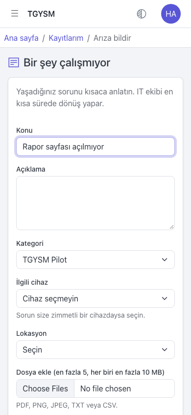

# Sorun bildirme ve geri bildirim

Bu sayfa pilot dönemindeki tüm kullanıcılar içindir. TGYSM'nin kendisiyle ilgili bir sorun görürseniz veya bir öneriniz varsa bunu TGYSM üzerinden bildirin.

## Ne bildirilir

- Bir ekran açılmıyor, bir düğme çalışmıyor, bir hata mesajı çıkıyor.
- Bir yazı yanlış, eksik veya anlaşılmıyor.
- Bir işlem çok yavaş.
- Bir şeyi yapmanın daha kolay bir yolu olmalı (öneri).

Bilgisayarınız, yazıcınız veya e-postanız gibi normal IT sorunlarını her zamanki gibi kendi kategorileriyle bildirin. "TGYSM Pilot" kategorisi yalnızca TGYSM'nin kendisi içindir.

## Nasıl bildirilir

1. **Ana sayfa** üzerindeki **Bir şey çalışmıyor** kartına basın.
2. **Konu** alanına sorunu kısaca yazın, örneğin "Rapor sayfası açılmıyor".
3. **Açıklama** alanına şunları yazın:
   - Ne yapmak istediniz?
   - Hangi adımları izlediniz?
   - Ne oldu, ne olmasını bekliyordunuz?
   - Ekranda bir hata mesajı çıktıysa tam metni.
   - Hangi cihazı ve tarayıcıyı kullandınız (örneğin "telefon, Safari" veya "bilgisayar, Chrome").
4. **Kategori** listesinden "TGYSM Pilot" seçin.
5. **Lokasyon** seçin.
6. Mümkünse ekran görüntüsünü **Dosya ekle (en fazla 5, her biri en fazla 10 MB)** alanından ekleyin.
7. **Gönder** düğmesine basın.

## Sonra ne olur

Bildiriminiz diğer kayıtlar gibi IT ekibine düşer. Durumunu **Kayıtlarım** sayfasından izleyebilir, soru gelirse **Yazışmalar** bölümünden yanıtlayabilirsiniz (bkz. [Kayıtlarım](my-tickets.md)).

## TGYSM'ye hiç giremiyorsanız

Giriş yapamıyor veya kayıt açamıyorsanız IT ekibine telefonla veya e-postayla ulaşın. Önce [Sorun giderme](troubleshooting.md) sayfasına bakın.
