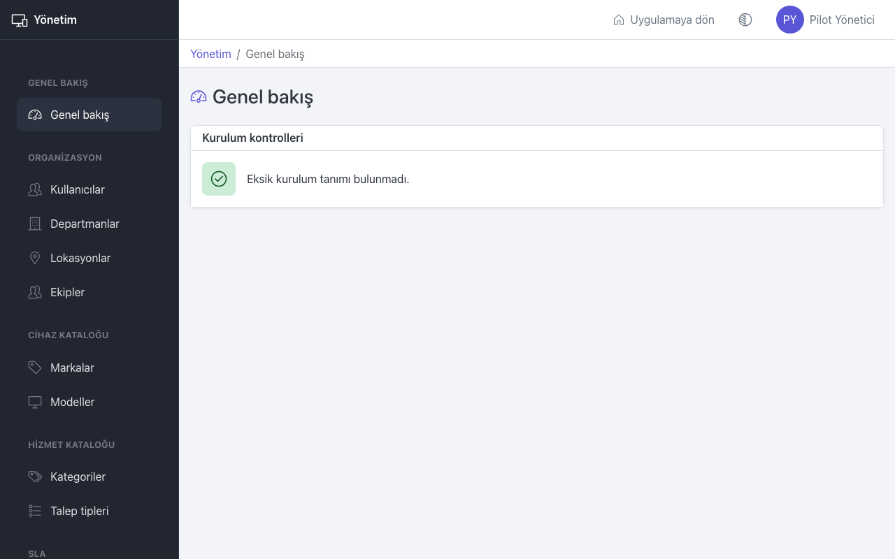

# İlk kurulum

Bu sayfa yöneticiler içindir: TGYSM'yi ilk kez kullanıma hazırlarken tanımların hangi sırayla girileceği. Sıra önemlidir; her adım bir öncekinde girilen bilgiyi kullanır.

İlk yönetici hesabını sistemi kuran kişi açar ve size e-posta adresinizi ve geçici şifrenizi verir. Giriş yapıp şifrenizi değiştirin (bkz. [Başlarken](getting-started.md)), sonra üst çubuktaki **Yönetim** bağlantısına basın.

## Adım 1: Lokasyonlar

Kullanıcılar, cihazlar ve kayıtlar bir lokasyona bağlanır; önce lokasyon ağacını kurun.

1. **Lokasyonlar** sayfasında binaları **Yeni lokasyon** ile ekleyin (örneğin "Merkez Ofis", "Fabrika").
2. Katları veya bölümleri ilgili binanın satırındaki **Alt lokasyon ekle** ile ekleyin (örneğin "Zemin Kat").

## Adım 2: Departmanlar

1. **Departmanlar** sayfasında her departmanı **Yeni departman** ile ekleyin.
2. **Onaylayıcı yönetici** alanını şimdilik boş bırakabilirsiniz; onaylayıcıların hesabı 3. adımda açılır.

## Adım 3: Yöneticiler ve IT personeli

1. **Kullanıcılar** sayfasında **Yeni kullanıcı** ile onaylayıcı olacak kişileri **Yönetici** rolüyle açın.
2. IT ekibindeki kişileri **IT personeli** rolüyle açın.
3. Her kişiye **Departman** ve **Lokasyon** seçin. **Şifre iletimi** için **E-posta ile bağlantı gönder** önerilir.

## Adım 4: Departman onaylayıcıları

**Departmanlar** sayfasında her departmanı **Düzenle** ile açıp **Onaylayıcı yönetici** seçin. Onaylayıcısı olmayan departmanların onay gerektiren talepleri onaylayıcısız kalır.

## Adım 5: Ekipler ve kayıt alan ekip

1. **Ekipler** sayfasında en az bir ekip açın (örneğin "Servis Masası").
2. Yeni kayıtları karşılayacak ekipte **Yeni kayıtları bu ekip alsın** kutusunu işaretleyin. Bu yapılmadan çalışanlar kayıt açamaz.
3. **Üyeleri yönet** ile IT personelini ekiplere ekleyin.

## Adım 6: Kategoriler

1. **Kategoriler** sayfasında ana kategorileri ve alt kategorileri ekleyin (en fazla iki seviye).
2. Her kategorinin **Kullanım** alanını seçin: **Arıza**, **Talep** veya **Arıza ve talep**.
3. Pilot dönemi için "TGYSM Pilot" adında, **Kullanım** değeri **Arıza** olan bir ana kategori ekleyin. Kullanıcılar sistemle ilgili sorunları bu kategoriyle bildirir (bkz. [Sorun bildirme ve geri bildirim](feedback.md)).

## Adım 7: Talep tipleri

**Talep tipleri** sayfasında çalışanların isteyebileceği şeyleri ekleyin (örneğin "Yeni bilgisayar", "Klasör erişimi"). Onaydan geçmesi gerekenlerde **Yönetici onayı gerekir** kutusunu işaretleyin.

## Adım 8: SLA takvimi ve politikası

1. **SLA takvimi** sayfasında **Saat dilimi** ve **Çalışma saatleri** girin, **Takvimi kaydet** ile kaydedin.
2. Yılın resmi tatillerini **Tatil ekle** ile ekleyin.
3. **SLA politikası** sayfasında hedefleri ve **Duraklatma kuralları** bölümünü gözden geçirin, **Yeni sürüm olarak kaydet** ile kaydedin.

Ayrıntılar: [Yönetim: SLA](admin-sla.md).

## Adım 9: Cihaz kataloğu

**Markalar** sayfasında markaları, **Modeller** sayfasında her markanın modellerini **Tür** seçerek ekleyin. CSV içe aktarmadaki her marka ve model burada tanımlı olmalıdır.

## Adım 10: Cihazları içe aktarma

Uygulamaya dönüp **Envanter** sayfasında **İçe aktar** ile mevcut cihazları CSV dosyasından yükleyin. "Konum" sütununa 1. adımdaki lokasyonların tam yolunu yazın, örneğin `Merkez Ofis / Zemin Kat`. Ayrıntılar: [Envanter](inventory.md).

## Adım 11: Çalışanlar

**Kullanıcılar** sayfasında çalışanları **Çalışan** rolüyle açın. Departmanlarını doğru seçin; talep onayları buna göre gider. Cihazları **Envanter** sayfasında **Teslim et** ile kişilere zimmetleyin.

## Adım 12: Kontrol

1. **Genel bakış** sayfasında **Kurulum kontrolleri** kartına bakın. **Eksik kurulum tanımı bulunmadı.** yazmalıdır.
2. **Sistem** sayfasında **Tüm işler zamanında çalışıyor.** yazmalıdır.
3. Bir çalışan hesabıyla deneme arızası açın; kaydın kayıt alan ekibe düştüğünü ve e-postanın geldiğini kontrol edin. **E-posta gönderimleri** sayfasında gönderimi görebilirsiniz.

## İpuçları

- **E-posta şablonları** sayfasında metinleri şirketinizin diline göre düzenleyebilirsiniz (bkz. [Yönetim: e-posta ve sistem](admin-email-and-system.md)).
- Tanımları sonradan değiştirmek mümkündür, ama kullanılan bir kaydı silmek yerine **Pasifleştir** kullanılır.
