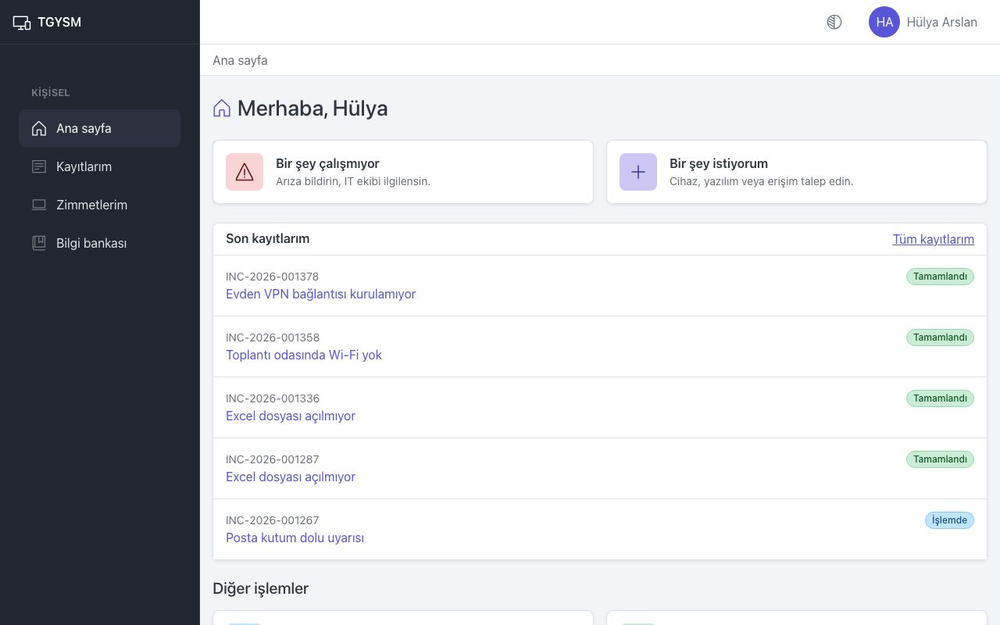
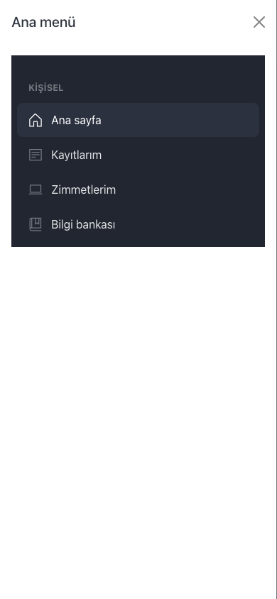
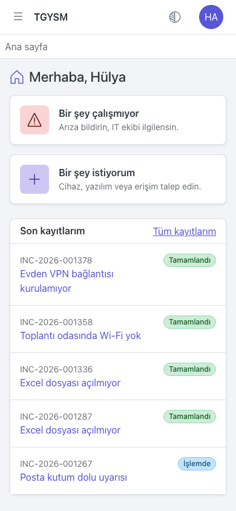

# Başlarken

Bu sayfa herkes içindir: TGYSM'ye nasıl girilir, şifre nasıl belirlenir ve ekranlar nasıl kullanılır.

## Hesabınız ve rolünüz

Hesabınızı yönetici açar. Her hesabın bir rolü vardır; ekranda gördüğünüz menüler bu role göre değişir.

| Rol | Neler yapabilir |
|---|---|
| **Çalışan** | Arıza bildirir, talep oluşturur, kendi kayıtlarını ve zimmetlerini görür, bilgi bankasını okur. |
| **IT personeli** | Çalışanın yaptıklarına ek olarak ekibine düşen kayıtları çözer, envanteri yönetir, makale yazar, raporları görür. |
| **Yönetici** | IT personelinin yaptıklarına ek olarak onay bekleyen talepleri karara bağlar ve **Yönetim** ekranlarını kullanır. |

Talepleri onaylayan kişiler (onaylayıcılar) her zaman **Yönetici** rolündedir.

## Hesabınızı etkinleştirme

Yöneticiniz hesabınızı açarken iki yoldan birini seçer:

- **E-posta ile bağlantı gönder**: E-posta kutunuza bir "Hesap etkinleştirme" iletisi gelir.
  1. İletideki bağlantıyı açın. **Şifre belirle** ekranı açılır.
  2. **Yeni şifre** ve **Yeni şifre (tekrar)** alanlarına aynı şifreyi yazın.
  3. **Şifreyi kaydet** düğmesine basın.
  4. **Giriş sayfasına git** bağlantısıyla giriş ekranına geçin.
- **Geçici şifre göster**: Yöneticiniz size bir geçici şifre verir. İlk girişte bu şifreyi değiştirmeniz istenir (aşağıya bakın).

Bağlantı sınırlı bir süre geçerlidir. Süresi dolduysa giriş ekranındaki **Şifremi unuttum** bağlantısıyla yenisini isteyin.

## Giriş yapma

1. Tarayıcınızda TGYSM adresini açın. **Giriş yap** ekranı gelir.
2. **E-posta** alanına iş e-posta adresinizi, **Şifre** alanına şifrenizi yazın.
3. **Giriş yap** düğmesine basın.

Art arda 5 hatalı denemede hesabınız 15 dakika kilitlenir. 15 dakika bekleyip tekrar deneyin.

## İlk girişte şifre değiştirme

Geçici şifre ile girdiyseniz **Şifre değiştir** ekranı açılır ve "İlk girişte şifrenizi değiştirmeniz gerekiyor." uyarısı görünür.

1. **Mevcut şifre** alanına size verilen geçici şifreyi yazın.
2. **Yeni şifre** ve **Yeni şifre (tekrar)** alanlarına yeni şifrenizi yazın.
3. **Şifreyi değiştir** düğmesine basın.

Şifre en az 12 karakter olmalı, harf ve rakam içermelidir. Yeni şifre eskisiyle aynı olamaz.

## Şifremi unuttum

1. **Giriş yap** ekranında **Şifremi unuttum** bağlantısına basın.
2. **E-posta** alanına adresinizi yazın ve **Bağlantı iste** düğmesine basın.
3. E-posta kutunuza gelen bağlantıyı açın ve **Şifre belirle** ekranında yeni şifrenizi kaydedin.

Ekranda her zaman aynı mesaj görünür; bu, adresin kayıtlı olup olmadığını başkalarının öğrenmesini engeller. E-posta gelmezse istenmeyen e-posta klasörüne bakın, yine yoksa yöneticinize başvurun.

## Ana sayfa

Giriş yaptıktan sonra **Ana sayfa** açılır.

- **Bir şey çalışmıyor**: Arıza bildirmek için.
- **Bir şey istiyorum**: Cihaz, yazılım veya erişim talep etmek için.
- **Son kayıtlarım**: Açtığınız son kayıtlar ve durumları. **Tüm kayıtlarım** bağlantısı listenin tamamını açar.
- **Diğer işlemler**: **Nasıl Yapılır?** (bilgi bankası) ve **Zimmetlerim**.

IT personeli ve yöneticiler ana sayfada ayrıca **İş kuyruklarım** bölümünü görür (bkz. [IT iş listesi](it-workspace.md)).

## Menü

Masaüstünde menü ekranın solunda her zaman açıktır. Menü rolünüze göre gruplanır:

- **Kişisel**: **Ana sayfa**, **Kayıtlarım**, **Zimmetlerim**, **Bilgi bankası**.
- **IT operasyonu** (IT personeli ve yönetici): **İş listem**, **Kuyruk**, **Envanter**; yöneticiler ayrıca **Onay yönetimi**.
- **Analiz** (IT personeli ve yönetici): **Raporlar**, **Dışa aktarımlarım**.

Menünün altındaki düğmeyle (**Menüyü daralt**) menüyü yalnızca simgelere indirebilirsiniz.

Telefonda menü gizlidir. Sol üstteki **Menüyü aç** düğmesine basın; menü soldan açılır. Bir sayfa seçince menü kendiliğinden kapanır.

Yöneticiler üst çubukta **Yönetim** bağlantısını görür. Yönetim ekranlarından uygulamaya **Uygulamaya dön** bağlantısıyla geri dönülür.

## Sayfa yolu

Üst çubuğun altında bulunduğunuz sayfanın yolu görünür, örneğin "Ana sayfa / Kayıtlarım / INC-2026-001378". Yoldaki bir adıma basarak o sayfaya dönebilirsiniz. Bir listeden kayıt açtıysanız, yoldaki liste adımı sizi aynı filtrelerle aynı listeye geri götürür.

## Hesap menüsü ve görünüm

Sağ üstteki adınıza (telefonda baş harflerinize) basınca hesap menüsü açılır:

- **Profilim**: Ad soyad, e-posta, rol, departman ve lokasyon bilgileriniz.
- **Şifre değiştir**: Şifrenizi istediğiniz zaman değiştirin.
- **Çıkış yap**: Oturumu kapatır.

Adınızın yanındaki **Görünüm** düğmesiyle ekranı **Açık**, **Koyu** veya **Otomatik** (cihazınızın ayarına göre) yapabilirsiniz.

## İpuçları

- Bilgileriniz (departman, lokasyon) yanlışsa yöneticinize bildirin; bunları yalnızca yönetici değiştirebilir.
- Ortak bir bilgisayar kullanıyorsanız işiniz bitince **Çıkış yap** ile çıkın.
