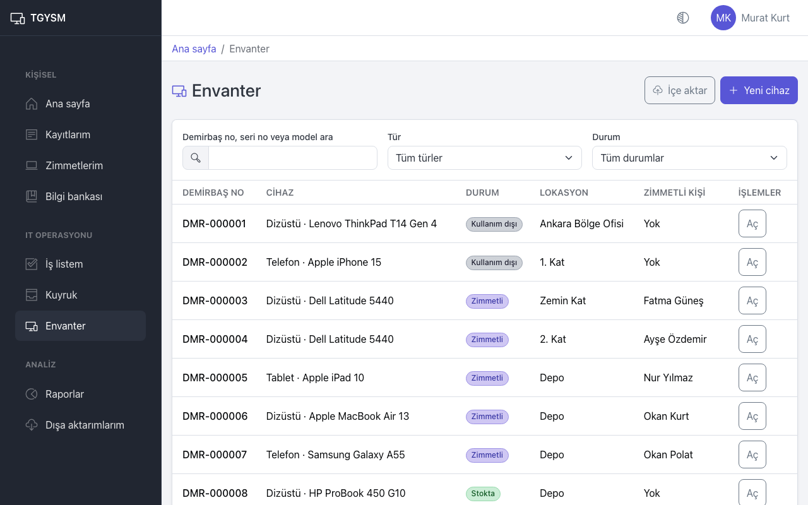
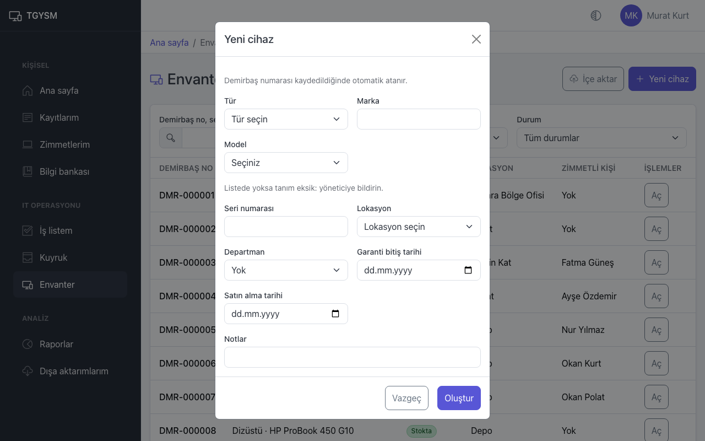
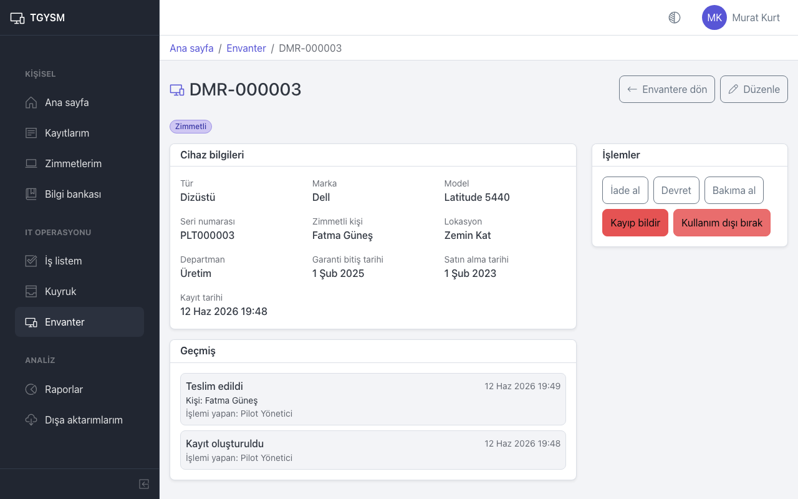
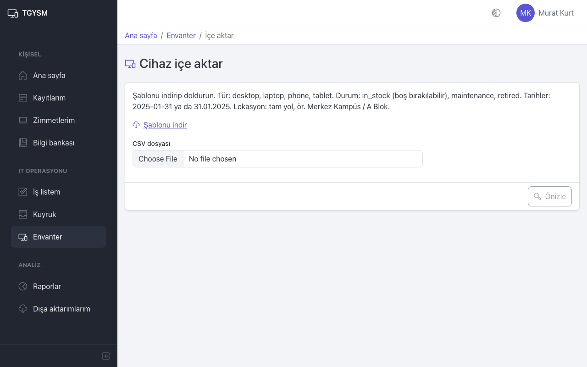

# Envanter

Bu sayfa IT personeli ve yöneticiler içindir: cihazları kaydetmek, teslim etmek, geri almak ve takip etmek.

## Cihaz listesi

1. Menüden **Envanter** sayfasını açın.
2. **Demirbaş no, seri no veya model ara** alanıyla arayın.
3. **Tür** (Masaüstü, Dizüstü, Telefon, Tablet) ve **Durum** listeleriyle süzün.
4. Cihazı açmak için satırdaki **Aç** düğmesine basın.

Cihaz durumları:

| Durum | Anlamı |
|---|---|
| **Stokta** | Depoda, kimseye verilmemiş. |
| **Zimmetli** | Bir kişiye teslim edilmiş. |
| **Bakımda** | Onarımda veya serviste. |
| **Kayıp** | Bulunamıyor. |
| **Kullanım dışı** | Hurdaya ayrılmış; üzerinde işlem yapılamaz. |

## Yeni cihaz kaydetme

1. **Envanter** sayfasında **Yeni cihaz** düğmesine basın.
2. **Tür** seçin. **Marka** ve **Model** listeleri bu türde tanımlı olanları gösterir.
3. **Marka** ve **Model** seçin. Aradığınız yoksa ekranda **Listede yoksa tanım eksik: yöneticiye bildirin.** yazar; yönetici cihaz kataloğuna eklemelidir (bkz. [Yönetim: cihaz ve hizmet kataloğu](admin-catalogs.md)).
4. **Seri numarası**, **Lokasyon** ve gerekiyorsa **Departman** girin.
5. Biliyorsanız **Garanti bitiş tarihi**, **Satın alma tarihi** ve **Notlar** girin.
6. **Oluştur** düğmesine basın.

Demirbaş numarası kaydedildiğinde otomatik atanır (`DMR-000001` gibi). Numarayı cihazın üzerine etiket olarak yapıştırın. Yeni cihaz **Stokta** durumunda başlar.

## Cihaz sayfası ve işlemler

Cihaz sayfasında **Cihaz bilgileri**, sağda **İşlemler** ve altta **Geçmiş** görünür. Bilgileri değiştirmek için **Düzenle** düğmesini kullanın.

**İşlemler** kartında yalnızca cihazın durumuna uygun işlemler çıkar:

| İşlem | Ne yapar | Doldurulacak alanlar |
|---|---|---|
| **Teslim et** | Stoktaki cihazı bir kişiye zimmetler. | **Kullanıcı ara**, **Kullanıcı**, isterseniz **Not** |
| **Devret** | Zimmetli cihazı başka bir kişiye geçirir. | **Kullanıcı ara**, **Kullanıcı**, isterseniz **Not** |
| **İade al** | Cihazı kişiden geri alır, stoğa koyar. | **Lokasyon** |
| **Bakıma al** | Cihazı bakıma gönderir. | Zimmetli cihazda **Kullanıcının sorumluluğu devam etsin** seçeneği |
| **Bakımı bitir** | Bakım biter. Sorumluluğu devam eden kullanıcı varsa cihaz ona döner, yoksa stoğa girer. | — |
| **Kayıp bildir** | Cihazı kayıp olarak işaretler. | **Neden** |
| **Bulundu** | Kayıp cihaz bulunur ve stoğa döner. | **Lokasyon** |
| **Kullanım dışı bırak** | Cihazı kalıcı olarak kullanımdan kaldırır. | **Neden** |

Her işlem **Onayla** ile kaydedilir ve **Geçmiş** bölümüne eklenir: ne yapıldı, kim yaptı, kime verildi.

Teslim edilen cihaz kişinin **Zimmetlerim** sayfasında görünür. Bir talep için teslim yapılıyorsa cihaz yalnızca talep sahibine verilebilir ve onay gereken taleplerde önce onay gelmiş olmalıdır.

## CSV ile toplu cihaz ekleme

Çok sayıda cihazı bir seferde eklemek için:

1. **Envanter** sayfasında **İçe aktar** düğmesine basın. **Cihaz içe aktar** ekranı açılır.
2. **Şablonu indir** ile örnek dosyayı indirin ve Excel'de doldurun.
3. Dosyayı Excel'de "CSV UTF-8 (virgülle ayrılmış)" biçiminde kaydedin.
4. **CSV dosyası** alanından dosyayı seçin ve **Önizle** düğmesine basın.
5. Özet satırını okuyun, örneğin "120 satır: 118 geçerli, 2 hatalı.".
   - Hatalı satır varsa **Hatalı satırlar** tablosunda satır numarası, alan ve sorun yazar. Dosyayı düzeltip yeniden yükleyin. Hatalı satır varken hiçbir cihaz eklenmez.
   - Hata yoksa **Eklenecek cihazlar** tablosunu kontrol edin ve **İçe aktar** düğmesine basın.

Dosya kuralları:

- Sütunlar: Demirbaş No, Tür, Marka, Model, Seri No, Konum, Departman, Durum, Garanti Bitiş, Satın Alma, Notlar. Demirbaş No, Tür, Marka, Model ve Konum sütunları dosyada mutlaka bulunmalıdır (şablonda hepsi vardır); Tür, Marka, Model ve Konum hücreleri her satırda dolu olmalıdır.
- Tür: `desktop`, `laptop`, `phone`, `tablet`. Durum: `in_stock` (boş bırakılabilir), `maintenance`, `retired`. Zimmetli veya kayıp cihaz içe aktarılamaz; onları içe aktardıktan sonra **Teslim et** ile zimmetleyin.
- Tarihler: `2025-01-31` ya da `31.01.2025`.
- Konum: lokasyonun tam yolu, örneğin `Merkez Ofis / Zemin Kat`. Adı tek olan bir alt lokasyon kendi adıyla da yazılabilir.
- Marka, tür ve model cihaz kataloğunda tanımlı olmalıdır; yoksa satırda "Tanım eksik" hatası çıkar.
- Demirbaş No sütunu silinmemeli, ama hücresi boş bırakılabilir: boş hücreye numara içe aktarma sırasında otomatik verilir (önizlemede **Otomatik** yazar). Eski bir etiket numarası yazabilirsiniz, ama `DMR-` ile başlayan numaralar sisteme ayrılmıştır.
- Dosya en fazla 10 MB ve 5.000 satır olabilir. Ayraç virgül veya noktalı virgül olabilir.

## İpuçları

- Cihazı bir arızaya bağlamak için kayıt sayfasındaki **Cihaz bağla** düğmesini kullanın (bkz. [IT iş listesi](it-workspace.md)).
- Listeden açtığınız cihazdan **Envantere dön** ile aynı arama ve filtrelere dönersiniz.
