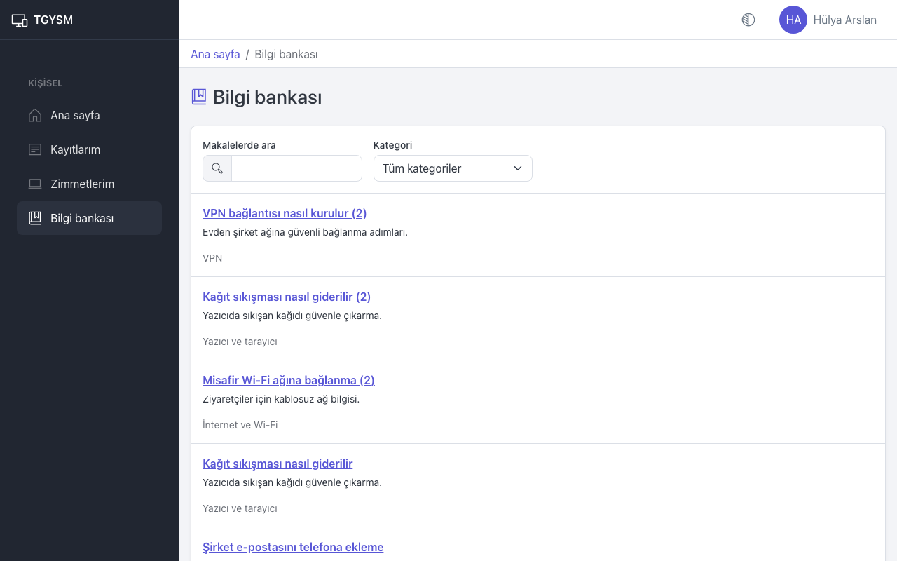
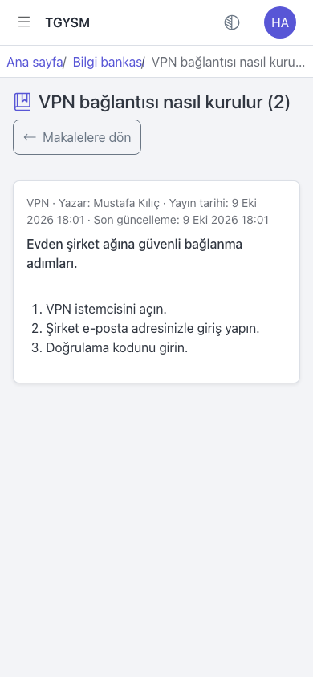
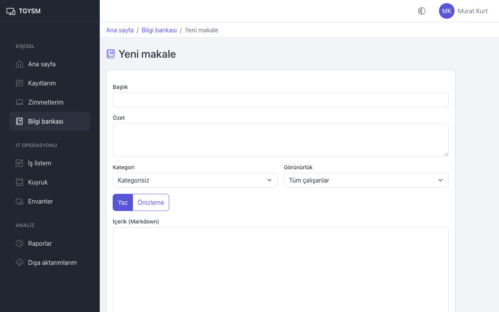

# Bilgi bankası

Bilgi bankası, sık karşılaşılan sorunların çözümlerini anlatan makalelerdir. Okumak herkes içindir; makale yazmak ve yayınlamak IT personeli ve yöneticiler içindir.

## Makale arama ve okuma

1. Menüden **Bilgi bankası** sayfasını açın. Ana sayfadaki **Nasıl Yapılır?** kartı da aynı sayfayı açar.
2. **Makalelerde ara** alanına bir kelime yazın, örneğin "yazıcı" veya "VPN".
3. İsterseniz **Kategori** listesinden bir konu seçin.
4. Okumak istediğiniz makalenin başlığına basın.

Makale sayfasında kategori, yazar, yayın tarihi ve son güncelleme görünür. Listeye **Makalelere dön** düğmesiyle dönersiniz; arama ve filtreleriniz korunur.

Arama ipuçları:

- Büyük-küçük harf fark etmez. "ı" ile "i" aynı sayılır: "yazici" yazınca "Yazıcı" da bulunur.
- Diğer Türkçe harfler aynı sayılmaz: "sifre" yazınca "şifre" bulunmaz. Türkçe harflerle yazın.
- Kelimenin bir parçası da yeter: "bağlan" yazınca "bağlantı" geçen makaleler de gelir.

Çalışanlar yalnızca yayında olan ve **Tüm çalışanlar** için açık makaleleri görür. Makale çözümü işe yaramadıysa [arıza bildirin](incidents-and-requests.md).

## Makale yazma (IT personeli ve yönetici)

1. **Bilgi bankası** sayfasında **Yeni makale** düğmesine basın.
2. **Başlık** ve **Özet** yazın. Özet listede başlığın altında görünür.
3. **Kategori** seçin (ya da **Kategorisiz** bırakın).
4. **Görünürlük** seçin:
   - **Tüm çalışanlar**: Yayınlanınca herkes görür.
   - **Yalnızca IT personeli**: Sadece IT personeli ve yöneticiler görür. İç çalışma notları için kullanın.
5. **İçerik (Markdown)** alanına metni yazın. Başlık, liste, bağlantı ve kalın/italik yazı kullanılabilir; HTML ve uzaktan görseller gösterilmez.
6. Nasıl görüneceğini görmek için **Önizleme** sekmesine, yazmaya dönmek için **Yaz** sekmesine basın.
7. **Kaydet** düğmesine basın. Makale **Taslak** olarak kaydedilir.

## Yayınlama, arşivleme, düzenleme

Makale sayfasında IT personeli şu düğmeleri görür:

- **Düzenle**: İçeriği değiştirir. Her kayıt **Sürüm geçmişi** bölümüne yeni bir sürüm ekler.
- **Yayınla**: Taslağı **Yayında** yapar.
- **Arşivle**: Makaleyi kaldırır; **Arşivlendi** olur ve çalışanlar artık görmez.
- **Taslağa geri al**: Arşivlenmiş makaleyi tekrar **Taslak** yapar.

IT personeli listede ayrıca **Durum** ve **Görünürlük** filtrelerini görür.

## Makaleyi bir kayda bağlama (IT personeli ve yönetici)

- Kayıt sayfasındaki **İlgili makaleler** kartında **Makale bağla** ile makaleyi kayda bağlayın. Çalışanlara açık olmayan bağlı makalelerin yanında **Çalışana gösterilmez** yazar.
- Yanıt yazarken **Makale ekle** ile bir makalenin bağlantısını mesaja ekleyebilirsiniz. Çalışana yazılan yanıta yalnızca **Tüm çalışanlar** makaleleri eklenebilir.

Ayrıntılar: [IT iş listesi](it-workspace.md).
