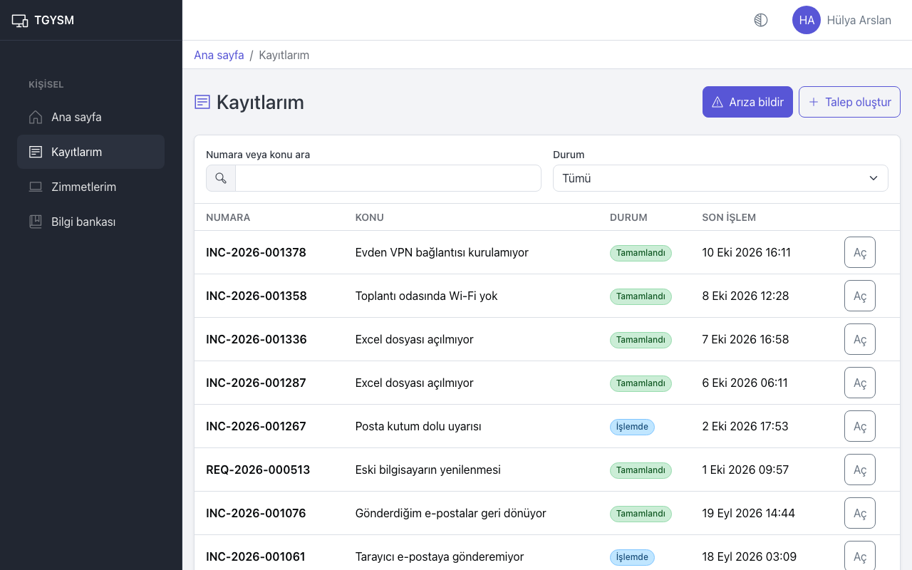
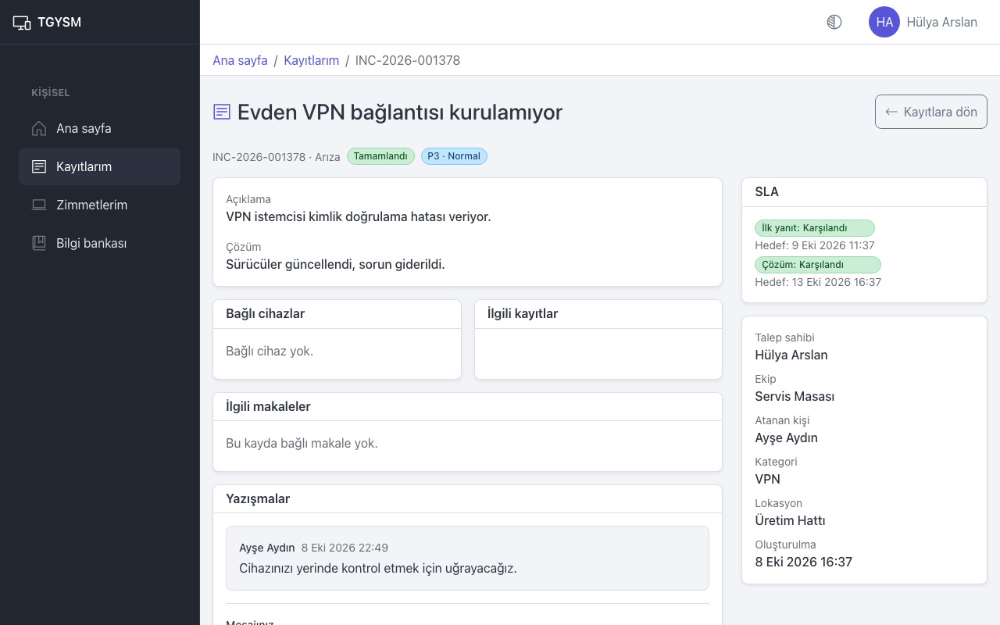

# Kayıtlarım

Bu sayfa herkes içindir: açtığınız arıza ve taleplerin durumunu izlemek ve IT ekibiyle yazışmak.

## Kayıtlarınızı listeleme

1. Menüden **Kayıtlarım** sayfasını açın.
2. Aradığınız kaydı bulmak için **Numara veya konu ara** alanına numarayı ya da konudan birkaç kelimeyi yazın.
3. **Durum** ve **Öncelik** listeleriyle süzün.
4. Kaydı açmak için satırdaki **Aç** düğmesine basın.

Liste her sayfada bir bölümü gösterir. Alttaki **Önceki** ve **Sonraki** düğmeleriyle sayfalar arasında geçin.

## Kayıt durumları

| Durum | Anlamı |
|---|---|
| **Açık** | Kayıt alındı, henüz üzerinde çalışılmıyor. |
| **İşlemde** | IT personeli üzerinde çalışıyor. |
| **Beklemede** | Bir şey bekleniyor: sizden yanıt, yönetici onayı, tedarikçi gibi. Neden kaydın sayfasında yazar. |
| **Tamamlandı** | İş bitti. Çözüm metni kaydın sayfasında yazar. |
| **İptal edildi** | Kayıt kapatıldı; iptal nedeni kaydın sayfasında yazar. |

## Kayıt sayfası

Kayıt sayfasında şunları görürsünüz:

- Başlıkta numara, tür, durum ve öncelik.
- **Açıklama** ve kayıt tamamlandıysa **Çözüm**.
- **SLA**: IT ekibinin size ilk yanıt vermesi ve kaydı çözmesi için hedef zamanlar. "Karşılandı" hedefin tutulduğunu gösterir.
- Sağdaki bilgi kartı: **Talep sahibi**, **Ekip**, **Atanan kişi**, **Kategori**, **Lokasyon**, **Oluşturulma**.
- Talep onay istiyorsa sağ üstte onay kutusu: onay durumu ve onaylayıcı.
- **Bağlı cihazlar**, **İlgili kayıtlar**, **İlgili makaleler**.
- **Yazışmalar**: Sizinle IT ekibi arasındaki mesajlar.
- **Geçmiş**: Kayıtta olan her şey, tarih sırasıyla.

## IT ekibine yanıt yazma

1. Kayıt sayfasında **Yazışmalar** bölümüne inin.
2. **Mesajınız** alanına yazın.
3. Gerekirse **Dosya ekle** ile dosya ekleyin.
4. **Gönder** düğmesine basın.

IT ekibi size bir şey sorduğunda kayıt genellikle **Beklemede** durumuna alınır ve neden **Kullanıcıdan yanıt bekleniyor** olur. Yanıt yazmanız işi hızlandırır.

Tamamlanmış bir kayda da yazabilirsiniz, ama kayıt yeniden açılmaz. Sorun tekrar ederse yeni bir kayıt açın ve eski kaydın numarasını açıklamaya yazın.

## Kayda cihaz bağlama

Kayıt açıkken sorunun hangi cihazda olduğunu sonradan da belirtebilirsiniz:

1. **Bağlı cihazlar** kartında **Cihaz bağla** düğmesine basın.
2. Size zimmetli cihazlardan birini seçin ve onaylayın.

## Kaydı iptal ettirmek

Çalışanlar kaydı kendileri iptal edemez. Artık gerekmiyorsa **Yazışmalar** bölümüne "Bu kayda artık ihtiyacım yok" diye yazın; IT ekibi kaydı iptal eder.

## İpuçları

- Ana sayfadaki **Son kayıtlarım** listesi son kayıtlarınızı hızlıca gösterir.
- Kaydınız oluştuğunda, IT ekibi size yanıt yazdığında, talebiniz onaylandığında veya reddedildiğinde ve kayıt tamamlandığında e-posta alırsınız.
